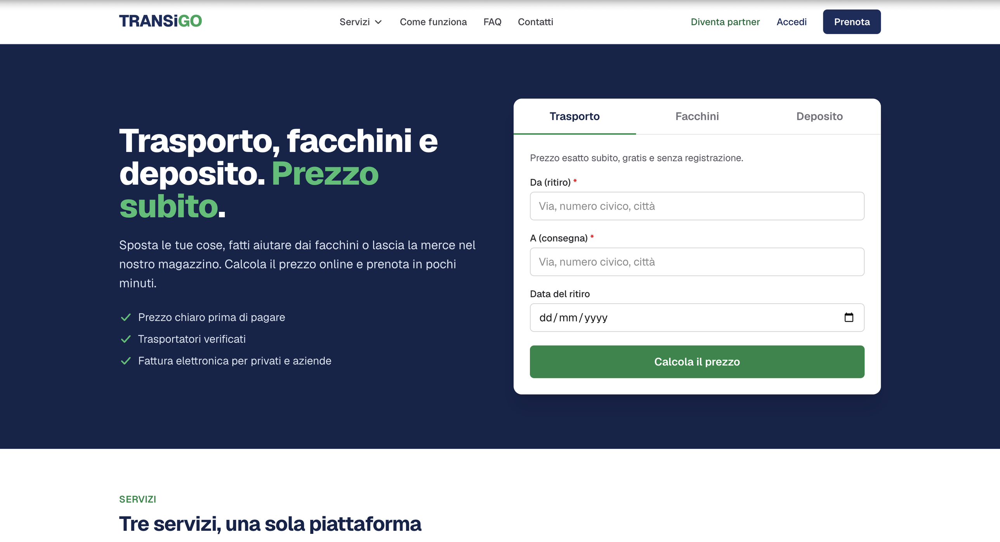
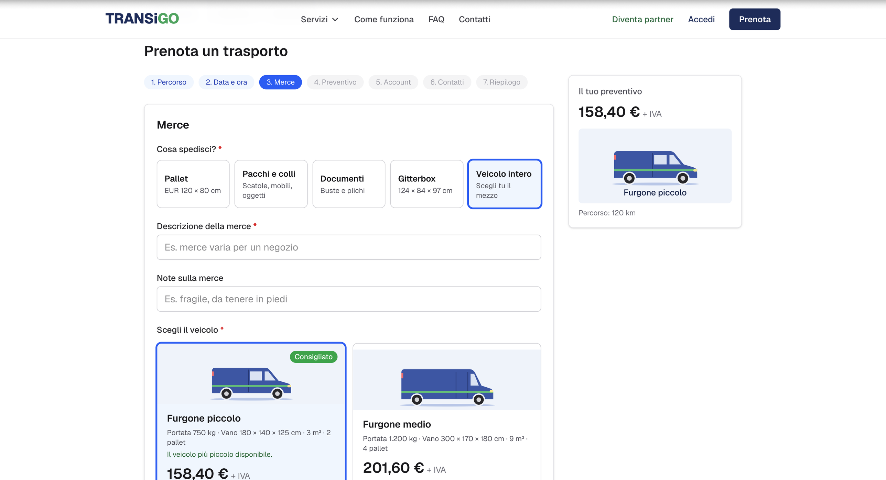
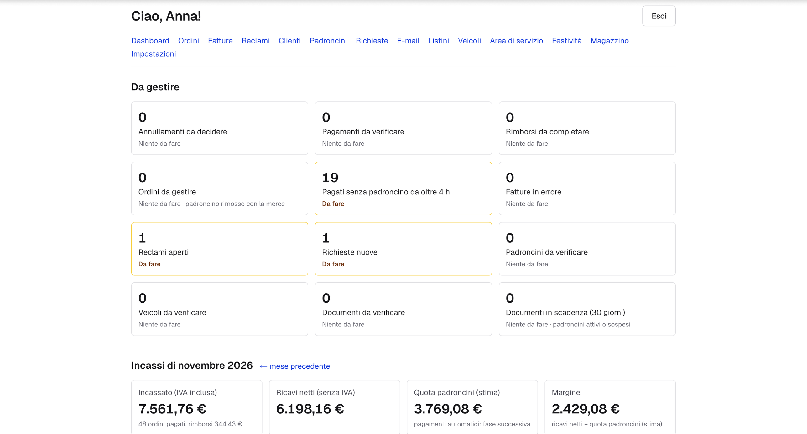
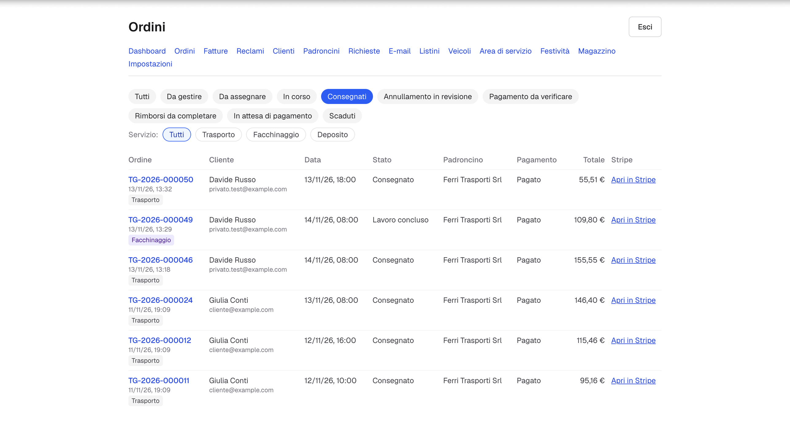
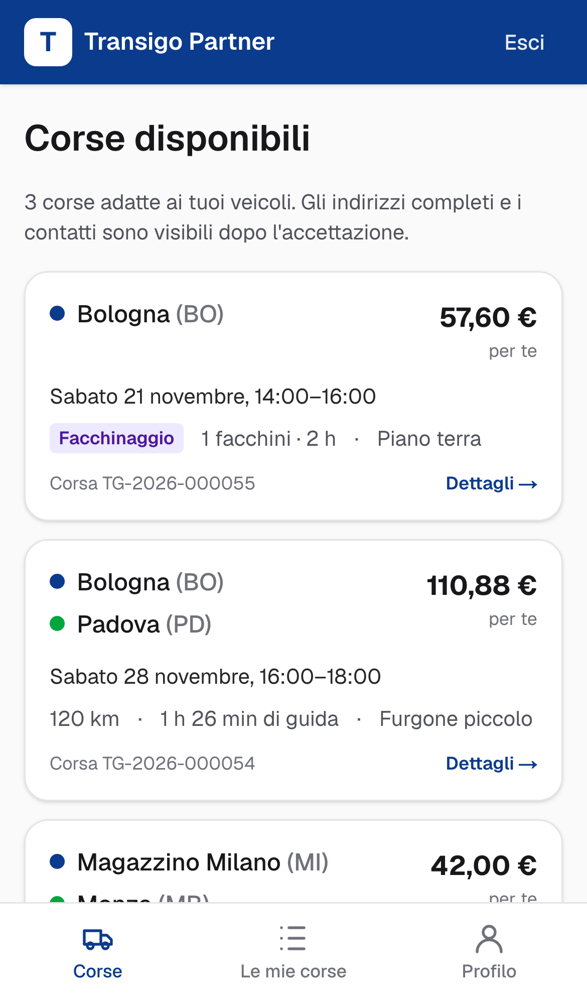
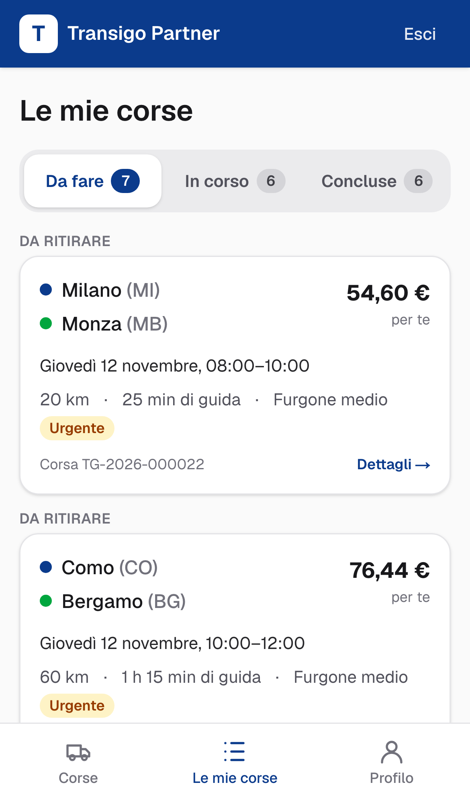
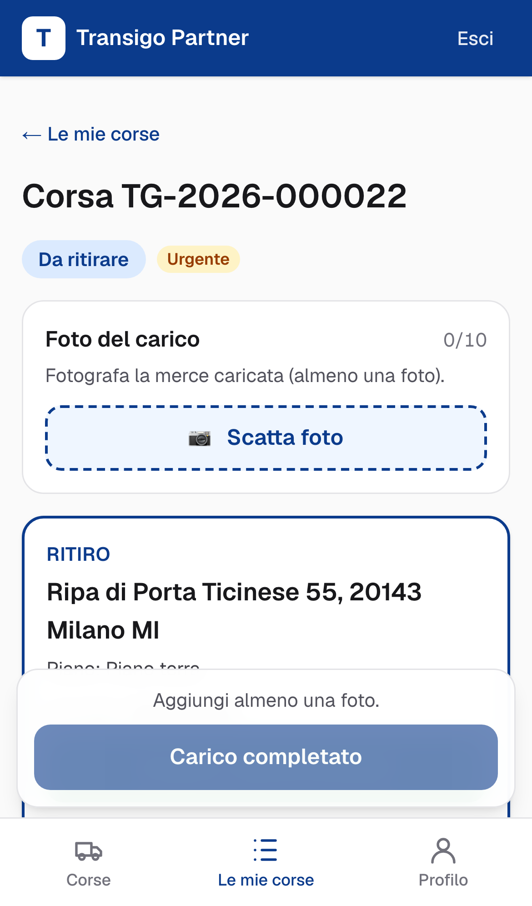

# Transigo

A logistics marketplace for Italy: customers book transport, porters (*facchinaggio*) or short-term storage online with a live price and pay up front, and the job goes to a network of small independent carriers (*padroncini*) who accept it in a mobile web app.

**Live demo (staging):** https://transigo-staging.vercel.app
Payments run in Stripe **test mode**. Use the card `4242 4242 4242 4242`, any future date and any CVC. No real money moves and no real emails are sent.

> The app interface is in Italian (the target market). Code, database names and comments are in English.

## Screenshots

| Home page with live quote | Booking wizard |
|---|---|
|  |  |

| Admin dashboard | Admin orders |
|---|---|
|  |  |

**Carrier app (PWA, mobile):** available jobs (anonymised until accepted), my jobs, job execution

<p>
  
  
  
</p>

## What it does

| Area | Highlights |
|---|---|
| **Public site** | Three services (Transport, Porters, Storage) with booking wizards and price calculators, FAQ with JSON-LD, contact form with rate limiting, cookie notice, sitemap and robots |
| **Booking & pricing** | Live quote from route distance (Google Maps) × per-km rate of the vehicle type, plus surcharges (weekend, floors without a lift, loading help, porters, storage per day or pallet). Service area limited by pickup province and maximum distance. Versioned price lists: a published list is immutable, changes go through a draft |
| **Payments** | Stripe Checkout. An order counts as paid **only** after the signed webhook, never after the redirect. Idempotent event handling, payment expiry, "payment review" for edge cases such as double payments, refunds through the Stripe Refunds API |
| **Customer panel** | Orders in progress and completed, details with price breakdown, cancellation with a fee and an automatic refund, claims with photos, storage overview, invoices (PDF), profile |
| **Admin panel** | Dashboard (to-do tiles, monthly revenue and margin), order dispatch (assign or remove a carrier, advance statuses), carrier verification (documents, vehicles, suspension), customers, refunds, claims, price lists, service area, warehouses, settings. Every admin action goes to an append-only audit log |
| **Carrier app (PWA)** | Onboarding with documents and vehicles, list of available jobs (anonymised until accepted), "Accept the job" with a race-safe lock, withdrawal rules, job execution steps, photos and proof of delivery with a signature |
| **E-invoicing** | Invoices and credit notes behind a provider adapter (`src/lib/einvoice`). The demo adapter generates watermarked PDFs. A real SDI provider (Fatture in Cloud) plugs into the same interface and passes the same contract test suite |
| **Linked orders** | "Pickup → storage → delivery" as separate linked orders with one payment and one invoice |

## Tech stack

- **Next.js 16** (App Router, Server Components, Server Actions, Cache Components), **React 19**, **TypeScript**, **Tailwind CSS 4**
- **Supabase**: Postgres, Auth, Storage, Row Level Security
- **Stripe**: Checkout, webhooks, Refunds (Connect Express planned for carrier payouts)
- **Google Maps Platform**: Places Autocomplete, route distance
- **Zod**, **pdf-lib**, **Vitest**, **Playwright**
- Hosted on **Vercel**

## Engineering highlights

- **Security in the database, not only in the UI.** Every table has RLS policies: a customer sees only their own orders, a carrier sees only assigned jobs plus an anonymised list of open ones, and only the admin sees everything. Data is split by visibility (for example, customers cannot read the carrier's share and carriers cannot read the customer's price). Sensitive writes (payments, invoices, order creation) are allowed only through `SECURITY DEFINER` functions, and even the service role has no direct `INSERT`/`UPDATE` on those tables.
- **Money as integers.** All amounts are euro cents (`integer`), never floats, with explicit and documented rounding. VAT is shown gross to private customers and net + VAT to businesses.
- **Concurrency-safe operations.** Accepting a job, booking warehouse capacity and payment confirmation run under row locks. Tests fire 2–10 parallel requests and check that exactly one wins.
- **Idempotency everywhere.** Stripe webhook events, refunds (`refund:<id>` idempotency keys), invoices and the email outbox are keyed so retries never duplicate side effects.
- **Pure domain logic.** Pricing, cancellation fees, refunds, invoice documents, dashboard numbers and order views are pure functions with unit tests. Thin server modules wire them to Supabase and Stripe.
- **Privileged code stays on the server.** The service-role key is never sent to the browser. Every Server Action checks the session first, and a test calls each exported admin action as an anonymous user, a customer and a carrier and asserts that nothing reaches the database.

## Testing

| Suite | What | Command |
|---|---|---|
| Unit | ~100 files (pricing, payments, refunds, invoices, views, actions) | `npm test` |
| RLS / database | 37 files against a real local Supabase (Docker), including policy checks for every role and race-condition tests | `npm run test:rls` |
| End-to-end | Playwright on iPhone, Android and desktop viewports: the carrier's delivery flow and admin corrections | `npm run test:e2e` |

RLS tests refuse to run against anything other than the local stack (`127.0.0.1`) and reset the database before each run.

## Project structure

```
src/
  app/
    (public)/       public site and booking wizards
    (cliente)/      customer panel
    (padroncino)/   carrier PWA
    (admin)/        admin panel
    api/            Stripe webhook, cron jobs, quotes, maps, invoice PDFs
  lib/
    pricing/        price engine (pure + tests)
    booking/        quotes and order creation per service
    orders/         dispatch, cancellation, refunds, linked orders
    payments/       Stripe Checkout and webhook handling
    einvoice/       e-invoicing adapter (demo provider + contract tests)
    carriers/ customers/ claims/ notifications/ ...
supabase/migrations/   schema, RLS policies and database functions (44 migrations)
tests/rls/             database security tests
tests/e2e/             Playwright tests
docs/                  functional spec, DB schema, plans, manual test scripts
```

## Running locally

Requirements: Node.js 20+, Docker (for local Supabase), a Stripe test account and a Google Maps API key.

```bash
npm install
cp .env.example .env.local          # fill in your own keys
npm run db:local:start              # local Supabase in Docker
npm run db:local:reset              # apply all migrations
npm run db:local:seed-demo          # demo data and accounts (password in .seed-local/password)
npm run dev
```

For local payments, forward Stripe webhooks:

```bash
stripe listen --forward-to localhost:3000/api/webhooks/stripe
```

## Status

Working demo of the public site, booking and payment, customer panel, admin panel and e-invoicing (demo provider). Next up: carrier payouts with Stripe Connect, live GPS tracking, a real SDI e-invoicing provider and SMS notifications.

## Author

Karol Wlosek

## License

© 2026 Karol Wlosek. All rights reserved. The source code is public for portfolio and review purposes only; it may not be copied, modified or used without written permission.
