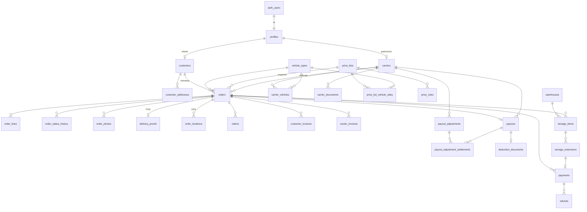

# Transigo — projekt schematu bazy danych

> Status: **PROJEKT do zatwierdzenia** (Etap 1b, 2026-11-08). Migracje powstaną dopiero po akceptacji.
> Źródło wymagań: [spec.md](spec.md). Nazwy w bazie po angielsku, opisy po polsku.

## 1. Konwencje

| Temat | Reguła |
|---|---|
| Klucze | `id uuid primary key default gen_random_uuid()`; wyjątki opisane przy tabeli (np. `profiles.id = auth.users.id`). |
| Czas | `timestamptz` (UTC); daty kalendarzowe (`paid_until`, święta) jako `date`. Każda tabela ma `created_at timestamptz not null default now()`; tabele edytowalne także `updated_at` (trigger). |
| Pieniądze | `*_cents integer` (EUR, centy). Nigdy `float`/`numeric` dla kwot. `check (... >= 0)` tam, gdzie kwota nie może być ujemna. |
| Procenty | `*_bp integer` — punkty bazowe (1 bp = 0,01 %; 22 % IVA = `2200`). Bez ułamków w bazie. |
| Dystans / czas trwania | `distance_m integer` (metry), `duration_s integer` (sekundy) — tak jak zwraca Google. |
| Współrzędne | `lat double precision`, `lng double precision` (to nie pieniądze; float jest OK). |
| Usuwanie | Brak twardego usuwania danych finansowych (zlecenia, płatności, faktury, wypłaty). Archiwizacja przez status / `is_active`. |
| Oznaczenia | 🔒 = pole zmieniane **wyłącznie przez serwer** (service role w route handlerze, webhook, cron lub funkcja `SECURITY DEFINER`). Klient i przewoźnik nigdy nie zapisują go bezpośrednio. |

### 1.1 Jak egzekwujemy „tylko serwer”

1. **Tabele finansowe i statusowe** (`orders`, `order_lines`, `payments`, `refunds`, `customer_invoices`, `payouts`, `payout_adjustments`, …) nie mają polityk `INSERT/UPDATE/DELETE` dla roli `authenticated`. Zapis robi wyłącznie serwer (klient Supabase z service role, tylko w kodzie serwerowym) po własnej walidacji.
2. **Akcje przewoźnika na zleceniu** (przyjęcie kursu, zmiana statusu, POD) idą przez funkcje RPC `SECURITY DEFINER`, które same sprawdzają uprawnienia i dozwolone przejścia statusów. Przykłady: `accept_job(order_id)` i `set_order_status(order_id, status, lat, lng)`.
3. **Kolumny chronione w tabelach edytowanych przez użytkownika** (np. `profiles.role`, `carriers.status`) są zabezpieczone uprawnieniami kolumnowymi (`grant update (col, …)`) i triggerem, który odrzuca zmianę, jeśli nie wykonuje jej service role.

### 1.2 Funkcje pomocnicze RLS

- `auth.uid()` — id zalogowanego użytkownika.
- `public.current_role() returns user_role`: `SECURITY DEFINER`, `stable`, czyta `profiles.role` dla `auth.uid()`. Dzięki temu polityki nie wpadają w rekurencję RLS.
- `public.is_admin() returns boolean`: `current_role() = 'admin'`.
- `public.is_active_carrier() returns boolean`: rola `padroncino`, `carriers.status = 'active'` i brak przeterminowanych zatwierdzonych dokumentów obowiązkowych.

---

## 2. Enumy

| Enum | Wartości | Uwagi |
|---|---|---|
| `user_role` | `cliente`, `padroncino`, `admin` | `admin` nadawany tylko ręcznie (SQL / service role). |
| `customer_type` | `private`, `business` | D3 — prezentacja cen. |
| `carrier_status` | `pending_review`, `active`, `rejected`, `suspended` | spec 8.1. |
| `carrier_document_type` | `transport_license`, `insurance_rca`, `goods_insurance`, `vehicle_registration`, `identity_document`, `driving_license` | |
| `review_status` | `pending`, `approved`, `rejected` | dokumenty przewoźnika. |
| `order_status` | `draft`, `pending_payment`, `expired`, `paid`, `assigned`, `picked_up`, `in_transit`, `delivered`, `completed`, `cancelled`, `refunded` | spec 4. |
| `status_source` | `customer_app`, `carrier_app`, `admin_panel`, `stripe_webhook`, `system_job` | skąd przyszła zmiana statusu. |
| `order_line_type` | `transport`, `surcharge_urgent`, `surcharge_weekend_holiday`, `surcharge_floors`, `porters`, `packing`, `storage` | pozycje rozbicia ceny. |
| `carrier_share_group` | `transport`, `porters`, `packing`, `none` | do której reguły D6 należy pozycja (dopłaty → `transport`, D14; magazyn → `none`). |
| `price_rule_code` | `surcharge_urgent`, `surcharge_weekend_holiday`, `surcharge_floor_no_elevator`, `porter_hour`, `packing_flat`, `packing_per_item`, `storage_day`, `storage_pallet_day`, `transshipment_flat`, `carrier_share_transport`, `carrier_share_porters`, `carrier_share_packing` | lista reguł cennika. |
| `price_rule_kind` | `fixed`, `percent`, `per_unit` | `fixed` = `amount_cents`; `percent` = `percent_bp`; `per_unit` = `amount_cents` × jednostka (piętro, osobogodzina, sztuka, dzień, paleta-dzień). |
| `price_list_status` | `draft`, `active`, `archived` | dokładnie jeden `active`. |
| `storage_type` | `transshipment`, `short_term`, `long_term` | spec 2.4. |
| `storage_billing_unit` | `day`, `pallet_day` | |
| `storage_item_status` | `expected`, `in_storage`, `released` | |
| `payment_purpose` | `order`, `storage_extension` | |
| `payment_status` | `pending`, `succeeded`, `expired`, `failed` | |
| `refund_status` | `pending`, `succeeded`, `failed` | |
| `invoice_kind` | `invoice`, `credit_note` | faktura / nota di credito. |
| `sdi_status` | `queued`, `sent`, `delivered`, `rejected`, `error` | UI: in coda, inviata, consegnata, scartata, errore. |
| `carrier_invoice_status` | `uploaded`, `matched`, `to_verify`, `accepted`, `rejected` | `matched` = automatycznie zgodna; `accepted` = zaakceptowana przez admina po `to_verify`. |
| `payout_status` | `not_ready`, `to_verify`, `waiting_window`, `ready`, `paid_out`, `on_hold`, `failed` | spec 4. |
| `claim_status` | `open`, `closed` | |
| `photo_kind` | `pickup`, `delivery`, `claim` | |
| `notification_channel` | `email`, `sms`, `push` | |
| `out_of_area_reason` | `pickup_province`, `max_distance` | D13. |

---

## 3. Tabele

### 3.1 Tożsamość i konta

#### `profiles` — jeden wiersz na użytkownika `auth.users`
| Kolumna | Typ | Uwagi |
|---|---|---|
| `id` | `uuid` PK, FK → `auth.users(id)` on delete cascade | |
| `role` | `user_role` not null | 🔒 Ustawiana przez trigger `on auth.users insert` z `raw_user_meta_data.role`. Dopuszczalne tylko `cliente`/`padroncino`; każda inna wartość, w tym `admin`, daje `cliente`. Na `admin` zmienia się wyłącznie ręcznie (SQL / service role). |
| `first_name` | `text` | |
| `last_name` | `text` | |
| `email` | `text` not null | 🔒 kopia z `auth.users`, synchronizowana triggerem (do list w panelu admina). |
| `phone` | `text` | format E.164. |
| `phone_verified_at` | `timestamptz` | 🔒 po weryfikacji SMS. |
| `is_blocked` | `boolean` not null default false | 🔒 blokada konta przez admina. |
| `privacy_accepted_at` | `timestamptz` | zgoda GDPR przy rejestracji. |
| `created_at`, `updated_at` | `timestamptz` | |

Indeksy: `unique(email)`, `(role)`.
**RLS:** użytkownik czyta i edytuje swój wiersz, ale bez kolumn 🔒. Admin czyta wszystko i ustawia `is_blocked`. Wiersz tworzy trigger; nikt nie tworzy go ani nie usuwa ręcznie, a usunięcie konta odbywa się przez serwer.

#### `customers` — dane klienta (1:1 z `profiles` o roli `cliente`)
| Kolumna | Typ | Uwagi |
|---|---|---|
| `profile_id` | `uuid` PK, FK → `profiles` | |
| `customer_type` | `customer_type` not null | wybierany przy rejestracji; zmiana tylko przez admina 🔒 (żeby nie przełączać IVA wstecz). |
| `company_name` | `text` | ragione sociale (wymagane dla `business`). |
| `vat_number` | `text` | P.IVA (wymagane dla `business`). |
| `fiscal_code` | `text` | codice fiscale (wymagane dla `private`). |
| `sdi_code` | `text` | codice destinatario (7 znaków). |
| `pec` | `text` | |
| `billing_street`, `billing_city`, `billing_postal_code`, `billing_province` | `text` | `billing_province` = sigla (np. `MI`). |
| `billing_country` | `char(2)` default `'IT'` | |
| `created_at`, `updated_at` | | |

Check: `business` → `company_name` i `vat_number` not null; `private` → `fiscal_code` not null. Walidacja formatu CF/P.IVA odbywa się w aplikacji.
**RLS:** klient czyta i edytuje swój wiersz (bez `customer_type`), admin wszystko. Przewoźnik nie ma dostępu.

#### `customer_addresses` — zapisane adresy klienta
`id`, `customer_id` FK → `customers`, `label text`, `address text`, `place_id text`, `lat`, `lng`, `city text`, `postal_code text`, `province char(2)`, `created_at`.
Indeks: `(customer_id)`.
**RLS:** klient pełny CRUD na swoich; admin czyta.

#### `carriers` — dane przewoźnika (1:1 z `profiles` o roli `padroncino`)
| Kolumna | Typ | Uwagi |
|---|---|---|
| `profile_id` | `uuid` PK, FK → `profiles` | |
| `status` | `carrier_status` not null default `pending_review` | 🔒 zmienia admin (przez serwer). |
| `status_reason` | `text` | 🔒 powód odrzucenia / zawieszenia. |
| `activated_at` | `timestamptz` | 🔒 |
| `activated_by` | `uuid` FK → `profiles` | 🔒 |
| `company_name` | `text` not null | ragione sociale |
| `vat_number` | `text` not null | P.IVA |
| `fiscal_code` | `text` | |
| `pec`, `sdi_code` | `text` | |
| `hq_street`, `hq_city`, `hq_postal_code`, `hq_province` | `text` | siedziba |
| `stripe_account_id` | `text` unique | 🔒 konto Connect Express |
| `stripe_details_submitted` | `boolean` not null default false | 🔒 z webhooka `account.updated` |
| `stripe_payouts_enabled` | `boolean` not null default false | 🔒 z webhooka `account.updated` (warunek 5 wypłaty) |
| `created_at`, `updated_at` | | |

Indeksy: `(status)`, `unique(vat_number)`.
**RLS:** przewoźnik czyta swój wiersz i edytuje dane firmowe (bez 🔒). Admin czyta wszystko; status zmienia przez serwer. Klient po przypisaniu widzi tylko imię przewoźnika i dane pojazdu, przez widok `order_carrier_public` (sekcja 4), a nie przez bezpośredni dostęp do tej tabeli.

#### `carrier_vehicles` — pojazdy przewoźnika
| Kolumna | Typ | Uwagi |
|---|---|---|
| `id` | `uuid` PK | |
| `carrier_id` | `uuid` FK → `carriers` | |
| `vehicle_type_id` | `uuid` FK → `vehicle_types` | |
| `plate` | `text` not null | tablica |
| `payload_kg` | `integer` | |
| `cargo_length_cm`, `cargo_width_cm`, `cargo_height_cm` | `integer` | |
| `is_active` | `boolean` not null default true | |
| `approved_at` | `timestamptz` | 🔒 zatwierdzenie przez admina |
| `created_at`, `updated_at` | | |

Indeksy: `(carrier_id)`, `(vehicle_type_id)`, `unique(plate)`.
**RLS:** przewoźnik CRUD na swoich pojazdach (bez `approved_at`; usunięcie tylko jako `is_active = false`). Admin wszystko.

#### `carrier_documents` — dokumenty przewoźnika (pliki w Storage)
| Kolumna | Typ | Uwagi |
|---|---|---|
| `id` | `uuid` PK | |
| `carrier_id` | `uuid` FK → `carriers` | |
| `vehicle_id` | `uuid` FK → `carrier_vehicles`, null | dla `vehicle_registration` |
| `doc_type` | `carrier_document_type` not null | |
| `storage_path` | `text` not null | bucket `carrier-documents` |
| `expires_at` | `date` | data ważności |
| `review_status` | `review_status` not null default `pending` | 🔒 |
| `reviewed_by` | `uuid` FK → `profiles` | 🔒 |
| `reviewed_at` | `timestamptz` | 🔒 |
| `rejection_reason` | `text` | 🔒 |
| `created_at` | | |

Indeksy: `(carrier_id, doc_type)`, `(expires_at)` dla alertów o wygasaniu (30 i 7 dni).
**RLS:** przewoźnik czyta swoje dokumenty i dodaje nowe; po weryfikacji nie może ich edytować, wgrywa nową wersję jako nowy wiersz. Admin czyta wszystko; weryfikację zapisuje serwer.

### 3.2 Konfiguracja (edytowana przez admina)

#### `vehicle_types` — typy pojazdów (D7)
| Kolumna | Typ | Uwagi |
|---|---|---|
| `id` | `uuid` PK | |
| `code` | `text` unique not null | np. `van_small` |
| `name_it` | `text` not null | np. „Furgone piccolo” |
| `payload_kg` | `integer` | |
| `cargo_length_cm`, `cargo_width_cm`, `cargo_height_cm` | `integer` | |
| `cargo_volume_dm3` | `integer` | 3 m³ = 3000 |
| `is_active` | `boolean` not null default true | |
| `sort_order` | `integer` not null default 0 | |
| `created_at`, `updated_at` | | |

Stawka/km i cena minimalna są w wersji cennika (`price_list_vehicle_rates`), a nie tutaj, żeby historia cen była wersjonowana. Patrz wątpliwość W1.
**RLS:** odczyt publiczny (`anon` + `authenticated`) aktywnych typów, bo kreator działa bez logowania. Zapis tylko admin.

#### `price_lists` — wersje cennika
| Kolumna | Typ | Uwagi |
|---|---|---|
| `id` | `uuid` PK | |
| `version` | `integer` unique not null | rosnący numer |
| `status` | `price_list_status` not null default `draft` | |
| `vat_rate_bp` | `integer` not null default 2200 | |
| `notes` | `text` | |
| `published_at` | `timestamptz` | |
| `published_by` | `uuid` FK → `profiles` | |
| `created_at`, `updated_at` | | |

Indeks: częściowy `unique (status) where status = 'active'` — gwarantuje jeden aktywny cennik.
Wersji `active` i `archived` nie można edytować (trigger). Zmiana cennika = nowy `draft` → publikacja.
**RLS:** odczyt aktywnego cennika: wszyscy, bo wycenę i tak liczy serwer, ale kreator pokazuje stawki. Pełny odczyt i zapis wersji `draft`: admin.

#### `price_list_vehicle_rates`
`price_list_id` FK, `vehicle_type_id` FK, `rate_per_km_cents integer not null check >= 0`, `min_price_cents integer not null check >= 0`. PK `(price_list_id, vehicle_type_id)`.
**RLS:** jak `price_lists`.

#### `price_rules` — dopłaty, usługi, magazyn, reguły kwoty przewoźnika
| Kolumna | Typ | Uwagi |
|---|---|---|
| `price_list_id` | `uuid` FK → `price_lists` | |
| `code` | `price_rule_code` | |
| `kind` | `price_rule_kind` not null | |
| `amount_cents` | `integer` | dla `fixed` / `per_unit` |
| `percent_bp` | `integer` | dla `percent` |
| `is_enabled` | `boolean` not null default true | |

PK `(price_list_id, code)`. Check: dokładnie jedno z `amount_cents` / `percent_bp` zgodnie z `kind`. Reguły `carrier_share_*` dopuszczają tylko `percent` lub `fixed` (D6).
**RLS:** jak `price_lists`.

#### `holidays` — święta włoskie (do dopłaty weekendowej/świątecznej)
`date date` PK, `name_it text`. **RLS:** odczyt publiczny, zapis admin. Patrz W11.

#### `service_area_provinces` — obsługiwane prowincje odbioru (D10, D13)
`province_code char(2)` PK (sigla), `name_it text`, `region_it text`, `is_active boolean`. **RLS:** odczyt publiczny, zapis admin.

#### `settings` — ustawienia globalne (jeden wiersz)
| Kolumna | Typ | Uwagi |
|---|---|---|
| `id` | `boolean` PK default true, check `id` | wymusza jeden wiersz |
| `payout_window_hours` | `integer` not null default 24 | D4 |
| `max_route_distance_m` | `integer` not null | D13 (admin wpisuje km, zapisujemy metry) |
| `gps_interval_s` | `integer` not null default 15 | D17 |
| `unassigned_alert_hours` | `integer` not null default 4 | dashboard: `paid` bez przewoźnika |
| `company_name`, `company_vat_number`, `company_fiscal_code`, `company_street`, `company_city`, `company_postal_code`, `company_province`, `company_pec`, `company_sdi_code`, `company_email`, `company_phone` | `text` | dane Transigo do faktur |
| `updated_at`, `updated_by` | | |

**RLS:** odczyt tylko admin. Wartości potrzebne publicznie, np. dane firmy w stopce, serwer podaje osobno. Zapis tylko admin.

#### `message_templates` — szablony e-mail / SMS
`code text`, `channel notification_channel`, `subject_it text`, `body_it text`, `updated_at`. PK `(code, channel)`. **RLS:** tylko admin.

#### `out_of_area_requests` — zapytania spoza obszaru obsługi
`id`, `name text`, `email text`, `phone text`, `pickup_address text`, `delivery_address text`, `distance_m integer`, `reason out_of_area_reason`, `message text`, `handled_at timestamptz`, `handled_by uuid`, `created_at`.
**RLS:** brak bezpośredniego zapisu z przeglądarki. Formularz wysyła dane do route handlera (walidacja + rate limit + e-mail do admina), a ten zapisuje przez serwer. Odczyt i obsługa: admin.

### 3.3 Zlecenia

#### `orders`
| Kolumna | Typ | Uwagi |
|---|---|---|
| `id` | `uuid` PK | |
| `order_number` | `text` unique not null | 🔒 np. `TG-2026-000123` (sekwencja) |
| `customer_id` | `uuid` FK → `customers` not null | |
| `status` | `order_status` not null default `draft` | 🔒 |
| `customer_type` | `customer_type` not null | 🔒 snapshot z chwili wyceny |
| **Trasa** | | |
| `pickup_address`, `delivery_address` | `text` not null | pełny adres |
| `pickup_place_id`, `delivery_place_id` | `text` | Google Place ID |
| `pickup_lat`, `pickup_lng`, `delivery_lat`, `delivery_lng` | `double precision` not null | |
| `pickup_city`, `delivery_city` | `text` not null | do zanonimizowanej listy kursów |
| `pickup_postal_code`, `delivery_postal_code` | `text` | |
| `pickup_province`, `delivery_province` | `char(2)` | `pickup_province` musi być w `service_area_provinces` (D13; sprawdza serwer) |
| `distance_m` | `integer` not null | 🔒 z Google Routes (serwer) |
| `duration_s` | `integer` | 🔒 |
| **Termin** | | |
| `pickup_date` | `date` not null | |
| `pickup_window_start`, `pickup_window_end` | `timestamptz` not null | |
| `is_urgent` | `boolean` not null default false | |
| **Towar i pojazd** | | |
| `vehicle_type_id` | `uuid` FK → `vehicle_types` not null | |
| `goods_description` | `text` not null | |
| `items_count` | `integer` | |
| `weight_kg` | `integer` | orientacyjnie |
| `goods_dimensions_note` | `text` | |
| **Usługi extra** | | |
| `pickup_floor`, `delivery_floor` | `smallint` default 0 | |
| `pickup_has_elevator`, `delivery_has_elevator` | `boolean` | |
| `porters_count` | `smallint` not null default 0 | |
| `porters_hours` | `smallint` not null default 0 | patrz W12 |
| `packing_items_count` | `integer` not null default 0 | 0 = bez pakowania |
| `storage_type` | `storage_type` | null = bez magazynu |
| `storage_billing_unit` | `storage_billing_unit` | |
| `storage_days` | `integer` | |
| `storage_pallets` | `integer` | |
| **Kontakty** | | |
| `pickup_contact_name`, `pickup_contact_phone`, `delivery_contact_name`, `delivery_contact_phone` | `text` not null | |
| `customer_notes` | `text` | |
| **Fakturowanie (snapshot)** | | |
| `billing_details` | `jsonb` not null | 🔒 kopia danych z `customers` w chwili zamówienia (CF / P.IVA / SDI / PEC / adres) |
| `terms_accepted_at` | `timestamptz` not null | |
| **Cena (snapshot)** | | |
| `price_list_id` | `uuid` FK → `price_lists` not null | 🔒 wersja cennika |
| `subtotal_cents` | `integer` not null check ≥ 0 | 🔒 netto |
| `vat_cents` | `integer` not null check ≥ 0 | 🔒 |
| `total_cents` | `integer` not null check ≥ 0 | 🔒 brutto = kwota w Stripe |
| `carrier_amount_cents` | `integer` not null check ≥ 0 | 🔒 suma `order_lines.carrier_amount_cents` |
| `refunded_cents` | `integer` not null default 0 | 🔒 suma udanych zwrotów |
| **Realizacja** | | |
| `carrier_id` | `uuid` FK → `carriers`, null | 🔒 przypisuje `accept_job()` lub admin |
| `carrier_vehicle_id` | `uuid` FK → `carrier_vehicles`, null | 🔒 |
| `assigned_at`, `picked_up_at`, `in_transit_at`, `delivered_at`, `completed_at`, `cancelled_at` | `timestamptz` | 🔒 |
| `paid_at` | `timestamptz` | 🔒 tylko z webhooka Stripe |
| `cancel_reason` | `text` | 🔒 |
| `tracking_token` | `text` unique | 🔒 publiczny link trackingu (W8) |
| `created_at`, `updated_at` | | |

Indeksy: `(customer_id, created_at desc)`, `(carrier_id, status)`, `(status, pickup_date)` dla listy dostępnych kursów, `(status, paid_at)` dla alertu „bez przewoźnika”, `unique(tracking_token)`.
Checki: `paid_at is not null` gdy status ∈ {`paid` … `completed`}; `carrier_id is not null` gdy status ∈ {`assigned`, `picked_up`, `in_transit`, `delivered`, `completed`}.
**RLS:**
- **cliente:** `select` swoich zleceń (`customer_id = auth.uid()`). Bez bezpośredniego `insert/update`: zlecenie tworzy i aktualizuje serwer, bo cena musi pochodzić z serwera (W3).
- **padroncino:** `select` zleceń, w których `carrier_id = auth.uid()`. Kursów `paid` nieprzypisanych **nie** widzi w tej tabeli, tylko przez funkcję `available_jobs()` (sekcja 4). Zmiany statusów robi wyłącznie przez RPC.
- **admin:** `select` wszystkiego; zmiany przez serwer (panel admina → route handler).

#### `order_lines` — rozbicie ceny (snapshot)
| Kolumna | Typ | Uwagi |
|---|---|---|
| `id` | `uuid` PK | |
| `order_id` | `uuid` FK → `orders` on delete cascade | |
| `line_type` | `order_line_type` not null | |
| `label_it` | `text` not null | tekst na fakturze / w podsumowaniu |
| `quantity` | `integer` not null default 1 | km, piętra, osobogodziny, dni… |
| `unit_amount_cents` | `integer` | |
| `amount_cents` | `integer` not null check ≥ 0 | netto, już zaokrąglone |
| `carrier_share_group` | `carrier_share_group` not null | |
| `carrier_amount_cents` | `integer` not null default 0 check ≥ 0 | część przewoźnika z tej pozycji |
| `sort_order` | `smallint` | |

Indeks: `(order_id)`. Wszystkie pola są 🔒 (wiersze zapisuje serwer razem z zamówieniem i nie zmienia ich później).
**RLS:** cliente czyta pozycje swoich zleceń. Padroncino czyta pozycje przypisanych zleceń, ale z jego perspektywy liczy się `carrier_amount_cents`; patrz W13. Admin czyta wszystko.

#### `order_status_history`
| Kolumna | Typ | Uwagi |
|---|---|---|
| `id` | `bigint` identity PK | |
| `order_id` | `uuid` FK → `orders` | |
| `from_status` | `order_status` | |
| `to_status` | `order_status` not null | |
| `changed_by` | `uuid` FK → `profiles`, null | null = system / webhook |
| `source` | `status_source` not null | |
| `reason` | `text` | wymagany przy zmianie przez admina |
| `lat`, `lng` | `double precision` | GPS przy zmianie przez przewoźnika |
| `created_at` | `timestamptz` | |

Indeks: `(order_id, created_at)`. Tylko 🔒 insert, wpisy nigdy nie są edytowane ani usuwane.
**RLS:** cliente czyta historię swoich zleceń (bez `reason` z panelu admina, przez widok), padroncino historię przypisanych, admin wszystko.

#### `order_internal_notes` — notatki wewnętrzne admina
`id`, `order_id` FK, `author_id` FK → `profiles`, `body text`, `created_at`. **RLS:** tylko admin.

#### `order_photos` — zdjęcia ładunku / dostawy / reklamacji
`id`, `order_id` FK, `kind photo_kind`, `claim_id uuid` FK null, `storage_path text`, `uploaded_by uuid`, `lat`, `lng`, `taken_at timestamptz`, `created_at`.
Indeks: `(order_id, kind)`.
**RLS:** przewoźnik dodaje zdjęcia `pickup`/`delivery` tylko do swojego zlecenia w statusie `assigned`…`in_transit` i czyta je. Klient czyta zdjęcia swoich zleceń i dodaje zdjęcia `claim` do swoich reklamacji. Admin wszystko.

#### `delivery_proofs` — POD (1:1 ze zleceniem)
`order_id uuid` PK FK, `recipient_name text not null`, `signature_path text not null`, `lat`, `lng`, `signed_at timestamptz not null`, `created_by uuid`.
Zapis przez RPC `complete_delivery(...)`, które w jednej transakcji zapisuje POD, sprawdza, że jest ≥ 1 zdjęcie `delivery`, ustawia status `delivered` i tworzy wiersz `payouts`.
**RLS:** przewoźnik (przez RPC) zapisuje POD dla swojego zlecenia i czyta go; klient czyta POD swoich zleceń; admin wszystko.

#### `order_locations` — punkty GPS w trakcie kursu
| Kolumna | Typ | Uwagi |
|---|---|---|
| `id` | `bigint` identity PK | |
| `order_id` | `uuid` FK → `orders` | |
| `carrier_id` | `uuid` FK → `carriers` | |
| `lat`, `lng` | `double precision` not null | |
| `accuracy_m` | `integer` | |
| `heading_deg`, `speed_kmh` | `smallint` | |
| `recorded_at` | `timestamptz` not null | |

Indeks: `(order_id, recorded_at desc)`. Tabela dodana do Supabase Realtime (mapa klienta).
**RLS:** przewoźnik `insert` tylko dla swojego zlecenia w statusie `picked_up` / `in_transit`. Klient `select` swoich zleceń, tylko od `picked_up` do `delivered`. Admin `select`. Retencja patrz W9.

#### `claims` — reklamacje
`id`, `order_id` FK, `opened_by uuid` FK → `profiles`, `status claim_status default 'open'` 🔒, `description text not null`, `resolution_note text` 🔒, `closed_by uuid` 🔒, `closed_at` 🔒, `created_at`, `updated_at`.
Indeks: `(order_id, status)`. Otwarcie reklamacji przestawia wypłatę na `on_hold` (logika serwera / trigger).
**RLS:** klient tworzy i czyta reklamacje swoich zleceń, admin wszystko i jako jedyny zamyka. Przewoźnik widzi, że do jego zlecenia jest otwarta reklamacja (status + opis), ale nie dane klienta; patrz W14.

### 3.4 Płatności i faktury klienta

#### `payments` — płatności Stripe (zlecenie albo przedłużenie magazynu)
| Kolumna | Typ | Uwagi |
|---|---|---|
| `id` | `uuid` PK | |
| `purpose` | `payment_purpose` not null | |
| `order_id` | `uuid` FK → `orders` not null | |
| `storage_extension_id` | `uuid` FK → `storage_extensions`, null | dla `storage_extension` |
| `amount_cents` | `integer` not null check > 0 | 🔒 |
| `status` | `payment_status` not null | 🔒 tylko webhook |
| `stripe_checkout_session_id` | `text` unique | 🔒 |
| `stripe_payment_intent_id` | `text` unique | 🔒 |
| `paid_at` | `timestamptz` | 🔒 |
| `created_at`, `updated_at` | | |

Indeks: `(order_id)`. Wszystkie pola 🔒.
**RLS:** klient czyta płatności swoich zleceń; admin wszystko; przewoźnik brak.

#### `refunds` — zwroty
| Kolumna | Typ | Uwagi |
|---|---|---|
| `id` | `uuid` PK | |
| `order_id`, `payment_id` | `uuid` FK | |
| `amount_cents` | `integer` not null check > 0 | 🔒 suma zwrotów ≤ kwota płatności (sprawdza serwer + trigger) |
| `reason` | `text` not null | |
| `status` | `refund_status` | 🔒 |
| `stripe_refund_id` | `text` unique | 🔒 |
| `after_payout` | `boolean` not null default false | 🔒 zwrot po wypłacie → koszt Transigo (D5) |
| `credit_note_id` | `uuid` FK → `customer_invoices` | 🔒 |
| `created_by` | `uuid` FK → `profiles` | admin |
| `created_at`, `updated_at` | | |

**RLS:** klient czyta zwroty swoich zleceń, bez `reason` z panelu admina (przez widok). Admin wszystko. Zapis wyłącznie przez serwer.

#### `stripe_events` — idempotencja webhooków
`event_id text` PK, `type text`, `account text` (dla eventów Connect), `received_at`, `processed_at`, `error text`.
**RLS:** brak dostępu dla `authenticated`; tylko service role. Admin czyta przez serwer.

#### `customer_invoices` — e-faktury i noty korygujące dla klienta (SDI)
| Kolumna | Typ | Uwagi |
|---|---|---|
| `id` | `uuid` PK | |
| `kind` | `invoice_kind` not null | |
| `order_id` | `uuid` FK → `orders` not null | |
| `payment_id` | `uuid` FK → `payments` | |
| `refund_id` | `uuid` FK → `refunds` | dla noty korygującej |
| `corrects_invoice_id` | `uuid` FK → `customer_invoices` | nota → faktura pierwotna |
| `provider` | `text` not null | np. `fatture_in_cloud` (adapter) |
| `provider_document_id` | `text` | |
| `number` | `text` | numer nadany przez dostawcę |
| `issue_date` | `date` | |
| `net_cents`, `vat_cents`, `total_cents` | `integer` not null | |
| `sdi_status` | `sdi_status` not null default `queued` | |
| `last_error` | `text` | |
| `attempts` | `smallint` not null default 0 | |
| `next_retry_at` | `timestamptz` | kolejka ponowień |
| `pdf_path` | `text` | bucket `invoices` |
| `created_at`, `updated_at` | | |

Wszystkie pola 🔒. Indeksy: `(order_id)`, `(sdi_status, next_retry_at)`, `unique(provider, provider_document_id)`.
**RLS:** klient czyta faktury swoich zleceń (bez `last_error`, przez widok). Admin wszystko. Przewoźnik brak.

### 3.5 Przewoźnik: faktury i wypłaty

#### `carrier_invoices` — faktury przewoźnika dla Transigo
| Kolumna | Typ | Uwagi |
|---|---|---|
| `id` | `uuid` PK | |
| `order_id` | `uuid` FK → `orders` | |
| `carrier_id` | `uuid` FK → `carriers` | |
| `storage_path` | `text` not null | PDF / XML w buckecie `carrier-invoices` |
| `file_type` | `text` check in (`pdf`,`xml`) | |
| `invoice_number` | `text` not null | |
| `invoice_date` | `date` not null | |
| `declared_amount_cents` | `integer` not null check ≥ 0 | kwota wpisana przez przewoźnika |
| `status` | `carrier_invoice_status` not null default `uploaded` | 🔒 walidacja automatyczna: `= orders.carrier_amount_cents` → `matched`, inaczej `to_verify` (D12) |
| `review_note` | `text` | 🔒 |
| `reviewed_by`, `reviewed_at` | | 🔒 |
| `created_at` | | |

Indeksy: `(order_id)`, `(carrier_id)`, częściowy `unique(order_id) where status <> 'rejected'` (jedna ważna faktura na zlecenie; po odrzuceniu można wgrać nową).
**RLS:** przewoźnik `insert` dla swojego zlecenia w statusie `delivered` (pola bez 🔒) i `select` swoich faktur. Admin wszystko. Klient brak.

#### `payouts` — wypłata za zlecenie (1:1 ze zleceniem po dostawie)
| Kolumna | Typ | Uwagi |
|---|---|---|
| `id` | `uuid` PK | |
| `order_id` | `uuid` FK → `orders` unique | |
| `carrier_id` | `uuid` FK → `carriers` | |
| `status` | `payout_status` not null default `not_ready` | 🔒 |
| `carrier_amount_cents` | `integer` not null check ≥ 0 | 🔒 = `orders.carrier_amount_cents` (kwota faktury) |
| `adjustments_cents` | `integer` not null default 0 check ≤ 0 | 🔒 potrącenia rozliczone w tej wypłacie |
| `transfer_amount_cents` | `integer` check ≥ 0 | 🔒 = kwota + potrącenia, min. 0 (D15) |
| `eligible_at` | `timestamptz` | 🔒 `delivered_at + payout_window_hours` |
| `hold_reason` | `text` | 🔒 |
| `held_by`, `held_at` | | 🔒 |
| `stripe_transfer_id` | `text` unique | 🔒 |
| `idempotency_key` | `text` unique not null | 🔒 np. `payout:<order_id>:<attempt>` |
| `attempts` | `smallint` not null default 0 | 🔒 |
| `failure_reason` | `text` | 🔒 |
| `paid_out_at` | `timestamptz` | 🔒 |
| `created_at`, `updated_at` | | |

Wszystkie pola 🔒. Indeksy: `(status, eligible_at)` dla crona co 15 min (D16), `(carrier_id, created_at desc)`.
**RLS:** przewoźnik czyta swoje wypłaty, w tym status `on_hold` i powód (W15). Admin wszystko. Klient brak.

#### `payout_adjustments` — potrącenia (D5, D12, D15)
| Kolumna | Typ | Uwagi |
|---|---|---|
| `id` | `uuid` PK | |
| `carrier_id` | `uuid` FK → `carriers` | |
| `order_id` | `uuid` FK → `orders`, null | zlecenie, którego dotyczy potrącenie |
| `refund_id` | `uuid` FK → `refunds`, null | |
| `amount_cents` | `integer` not null check < 0 | 🔒 potrącenie (ujemne) |
| `reason` | `text` not null | |
| `created_by` | `uuid` FK → `profiles` | admin |
| `created_at` | | |

**RLS:** przewoźnik czyta swoje potrącenia; admin wszystko. Zapis wyłącznie przez serwer.

#### `payout_adjustment_settlements` — rozliczenie potrącenia w konkretnej wypłacie
`adjustment_id` FK, `payout_id` FK, `amount_cents integer not null check < 0`, `created_at`. PK `(adjustment_id, payout_id)`.
Dzięki tej tabeli potrącenie większe niż wypłata można rozbić na kilka wypłat (D15). Pozostało do rozliczenia = `adjustment.amount_cents − Σ settlements.amount_cents`. Wszystkie pola 🔒.
**RLS:** jak `payout_adjustments`.

#### `deduction_documents` — dokument potrącenia (D12, rodzaj **[DO POTWIERDZENIA Z COMMERCIALISTA]**)
`id`, `payout_id` FK unique, `carrier_id` FK, `total_cents integer not null check < 0`, `document_number text`, `pdf_path text`, `created_at`. Wszystkie pola 🔒.
**RLS:** przewoźnik czyta swoje; admin wszystko.

### 3.6 Magazyn (D9)

#### `warehouses`
`id`, `name text`, `street`, `city`, `postal_code`, `province char(2)`, `is_active boolean`, `created_at`, `updated_at`.
**RLS:** admin CRUD; reszta brak (adres magazynu w kreatorze podaje serwer).

#### `storage_items` — pozycja składowana
| Kolumna | Typ | Uwagi |
|---|---|---|
| `id` | `uuid` PK | |
| `order_id` | `uuid` FK → `orders` | |
| `customer_id` | `uuid` FK → `customers` | |
| `warehouse_id` | `uuid` FK → `warehouses` | |
| `storage_type` | `storage_type` not null | |
| `billing_unit` | `storage_billing_unit` not null | |
| `pallets_count` | `integer` | |
| `location_code` | `text` | miejsce w magazynie |
| `status` | `storage_item_status` not null default `expected` | |
| `checked_in_at`, `checked_out_at` | `timestamptz` | |
| `paid_until` | `date` not null | 🔒 przesuwane tylko po webhooku płatności |
| `created_at`, `updated_at` | | |

Indeksy: `(customer_id)`, `(warehouse_id, status)`, `(paid_until)` dla alertów o kończącym się okresie.
**RLS:** klient czyta swoje pozycje (bez `location_code`). Admin wszystko i edytuje pola operacyjne (przyjęcie, wydanie, lokalizacja). `paid_until` zmienia tylko serwer.

#### `storage_extensions` — przedłużenie składowania
`id`, `storage_item_id` FK, `days integer not null check > 0`, `amount_cents integer not null` 🔒, `new_paid_until date` 🔒, `stripe_payment_link_url text` 🔒, `status payment_status` 🔒, `created_by uuid`, `created_at`, `updated_at`.
Płatność trafia do `payments` (`purpose = storage_extension`). Fakturę wystawia ten sam mechanizm co dla zlecenia.
**RLS:** klient czyta przedłużenia swoich pozycji; admin wszystko; zapis tylko serwer.

### 3.7 Powiadomienia i audyt

#### `notification_log`
`id bigint identity`, `recipient_id uuid` FK null, `recipient_address text` (e-mail / telefon), `channel notification_channel`, `template_code text`, `order_id uuid` null, `status text` (`sent`/`failed`), `provider_message_id text`, `error text`, `created_at`.
**RLS:** tylko admin (odczyt); zapis serwer.

#### `audit_log` — działania admina i zdarzenia systemowe
`id bigint identity`, `actor_id uuid` null, `action text` (np. `payout.hold`, `carrier.activate`, `order.refund`), `entity_type text`, `entity_id uuid`, `data jsonb`, `created_at`.
Indeks: `(entity_type, entity_id, created_at)`.
**RLS:** tylko admin (odczyt); zapis serwer. Wpisy nie są edytowane.

---

## 4. Widoki i funkcje RPC (dostęp kontrolowany)

| Obiekt | Typ | Kto | Co robi |
|---|---|---|---|
| `available_jobs()` | funkcja `SECURITY DEFINER` → tabela | aktywny przewoźnik | Zwraca zlecenia `paid` bez przewoźnika, pasujące do typów jego aktywnych pojazdów (W6). Pola: `id`, miasto i prowincja odbioru/dostawy, data i okno, `distance_m`, typ pojazdu, flagi usług extra (piętra, tragarze, pakowanie), `carrier_amount_cents`. **Bez** adresów, nazwisk, telefonów i cen klienta. |
| `accept_job(order_id)` | funkcja `SECURITY DEFINER` | aktywny przewoźnik | Atomowo: `update orders set carrier_id = auth.uid(), status = 'assigned' … where id = $1 and status = 'paid' and carrier_id is null returning …`. 0 wierszy → „Corsa già assegnata”. Zapisuje historię statusu. |
| `set_order_status(order_id, to_status, lat, lng)` | funkcja `SECURITY DEFINER` | przypisany przewoźnik | Tylko przejścia `assigned→picked_up` (wymaga zdjęcia `pickup`) i `picked_up→in_transit`. |
| `complete_delivery(order_id, recipient_name, signature_path, lat, lng)` | funkcja `SECURITY DEFINER` | przypisany przewoźnik | `in_transit→delivered` + POD + utworzenie `payouts` (`not_ready`). |
| `order_carrier_public` | widok | klient (swoje zlecenia) | Po przypisaniu: imię przewoźnika, typ pojazdu, tablica. |
| `tracking_by_token(token)` | funkcja `SECURITY DEFINER` | `anon` | Tylko jeśli W8 = tak: status + ostatnia pozycja, bez danych osobowych. |

Funkcje `SECURITY DEFINER` mają `set search_path = ''` i same sprawdzają `auth.uid()` i rolę.

## 5. Supabase Storage (prywatne buckety, dostęp przez signed URL)

| Bucket | Ścieżka | Kto wgrywa | Kto czyta |
|---|---|---|---|
| `carrier-documents` | `{carrier_id}/{document_id}.{ext}` | przewoźnik (swój folder) | przewoźnik (swój), admin |
| `order-photos` | `{order_id}/{photo_id}.jpg` | przewoźnik przypisany do zlecenia; klient (zdjęcia reklamacji) | klient zlecenia, przewoźnik przypisany, admin |
| `signatures` | `{order_id}.png` | przewoźnik przypisany | klient zlecenia, przewoźnik przypisany, admin |
| `carrier-invoices` | `{carrier_id}/{order_id}/{invoice_id}.{pdf\|xml}` | przewoźnik (swój folder) | przewoźnik (swój), admin |
| `invoices` | `{order_id}/{invoice_id}.pdf` | serwer | klient zlecenia, admin |
| `deduction-documents` | `{carrier_id}/{document_id}.pdf` | serwer | przewoźnik (swój), admin |

## 6. Podsumowanie RLS (macierz)

R = odczyt, W = zapis bezpośredni z aplikacji (z RLS), S = zapis tylko przez serwer/RPC, „—” = brak dostępu. „własne” = powiązane z `auth.uid()`.

| Tabela | cliente | padroncino | admin |
|---|---|---|---|
| `profiles` | R/W własny (bez 🔒) | R/W własny (bez 🔒) | R, S |
| `customers` | R/W własny (bez typu) | — | R, S |
| `customer_addresses` | R/W własne | — | R |
| `carriers` | — (tylko widok publiczny po przypisaniu) | R/W własny (bez 🔒) | R, S |
| `carrier_vehicles` | — | R/W własne | R/W |
| `carrier_documents` | — | R + insert własne | R, S |
| `vehicle_types`, `service_area_provinces`, `holidays` | R (także `anon`) | R | R/W |
| `price_lists`, `price_list_vehicle_rates`, `price_rules` | R aktywny | R aktywny | R/W (draft) |
| `settings`, `message_templates` | — | — | R/W |
| `out_of_area_requests` | — (S przez formularz) | — | R/W |
| `orders` | R własne, S | R przypisane, S (RPC) | R, S |
| `order_lines` | R własne | R przypisane | R |
| `order_status_history` | R własne | R przypisane | R |
| `order_internal_notes` | — | — | R/W |
| `order_photos` | R własne, W `claim` | R/W przypisane (`pickup`/`delivery`) | R/W |
| `delivery_proofs` | R własne | R, S (RPC) | R |
| `order_locations` | R własne (picked_up…delivered) | W przypisane (w trakcie kursu) | R |
| `claims` | R + insert własne | R przypisane (W14) | R, S |
| `payments`, `refunds` | R własne | — | R, S |
| `stripe_events` | — | — | — (tylko service role) |
| `customer_invoices` | R własne | — | R, S |
| `carrier_invoices` | — | R + insert własne | R, S |
| `payouts`, `payout_adjustments`, `payout_adjustment_settlements`, `deduction_documents` | — | R własne | R, S |
| `warehouses` | — | — | R/W |
| `storage_items` | R własne | — | R/W (bez `paid_until`) |
| `storage_extensions` | R własne | — | R, S |
| `notification_log`, `audit_log` | — | — | R |

Zablokowany użytkownik (`profiles.is_blocked`) nie przechodzi przez żadną politykę, bo każda polityka sprawdza `not is_blocked`. Proxy dodatkowo go wylogowuje.

## 7. Diagram relacji

## 8. Wątpliwości do rozstrzygnięcia przed migracjami

| # | Temat | Propozycja |
|---|---|---|
| W1 | Gdzie trzymać stawkę/km i cenę minimalną pojazdu | W wersji cennika (`price_list_vehicle_rates`), nie w `vehicle_types`. Edycja stawek = nowa wersja cennika, dzięki czemu historia jest spójna. |
| W2 | Cennik: tabele vs jeden `jsonb` | Tabele (`price_rules` z enumem kodów). Baza pilnuje typów (centy, bp), a zmiany są łatwe do audytu. |
| W3 | Tworzenie zleceń | Wyłącznie przez serwer (route handler liczy cenę i zapisuje zlecenie + pozycje), bez `INSERT` z przeglądarki. |
| W4 | Przystanki pośrednie | Poza MVP. Na razie kolumny `pickup_*` i `delivery_*` w `orders`; przystanki później jako osobna tabela `order_stops`. |
| W5 | Warunki przyjęcia kursu | `carriers.status = active` + zatwierdzone, nieprzeterminowane dokumenty obowiązkowe + **`stripe_payouts_enabled = true`**, żeby nikt nie wykonał kursu bez możliwości wypłaty. |
| W6 | Dopasowanie kursu do pojazdu | Przewoźnik widzi kursy dla typów, które ma. Do ustalenia: czy także dla mniejszych typów (np. przewoźnik z 3,5 t widzi kursy na furgone piccolo)? Propozycja: tylko dokładny typ. |
| W7 | Konto firmowe | Jedno konto = jeden użytkownik; brak wielu użytkowników jednej firmy w MVP. |
| W8 | Publiczny link trackingu dla odbiorcy | Kolumna `tracking_token` przygotowana (nullable); funkcja `tracking_by_token` tylko po decyzji „tak”. |
| W9 | Retencja GPS | Usuwanie punktów `order_locations` po 30 dniach od `delivered` (cron). |
| W10 | Faktura klienta | Jedna faktura na płatność (zlecenie albo przedłużenie magazynu), pozycje z `order_lines`. Zwrot = nota korygująca powiązana z fakturą. |
| W11 | Święta | Tabela `holidays` edytowana przez admina, zasilona świętami włoskimi (w tym Wielkanocny Poniedziałek). Czy dodać święta lokalne (patron miasta)? Propozycja: tylko krajowe. |
| W12 | Tragarze | Klient deklaruje liczbę osób i godzin w kreatorze, płaci z góry. Czy dopuszczamy dopłatę za nadgodziny po fakcie? Propozycja: nie w MVP. |
| W13 | Co przewoźnik widzi z ceny | Tylko swoją kwotę (`carrier_amount_cents`) i pozycje usług, bez kwot klienta i marży Transigo. Odczyt `order_lines` dla przewoźnika przez widok bez `amount_cents`. |
| W14 | Reklamacja a przewoźnik | Przewoźnik widzi, że jest otwarta reklamacja i jej opis (wyjaśnia wstrzymanie wypłaty), bez danych klienta. Czy może odpowiadać? Propozycja: nie w MVP, kontakt przez admina. |
| W15 | Powód wstrzymania wypłaty | Przewoźnik widzi status `on_hold` i powód wpisany przez admina. |
| W16 | Częściowy zwrot **przed** wypłatą | Czy zmniejsza `carrier_amount` (i wtedy fakturę przewoźnika)? Propozycja: nie automatycznie; admin decyduje i ewentualnie dodaje potrącenie. Faktura pozostaje na pełną kwotę (D12). |
| W17 | Anulowanie po przypisaniu | Czy przewoźnik dostaje rekompensatę za anulowany kurs? Propozycja: poza MVP; admin może ręcznie. Schemat tego nie przewiduje. |
| W18 | Weryfikacja SMS telefonu | Twilio Verify (nasz kod) czy Supabase Phone Auth? Propozycja: Twilio Verify, logowanie zostaje e-mailowe; `phone_verified_at` w `profiles`. |
| W19 | GDPR „usuń dane” vs obowiązek przechowywania faktur (10 lat) | Anonimizacja profilu (imię, telefon, adresy) zamiast usunięcia; zlecenia i faktury zostają z danymi fiskalnymi ze snapshotu. |
| W20 | Dane do faktury per zlecenie | Domyślnie z profilu, klient może je zmienić w kroku „Riepilogo” dla danego zlecenia (snapshot w `orders.billing_details`) bez zmiany profilu. |
| W21 | Kto tworzy wiersz `customers` / `carriers` | Serwer po rejestracji (formularz → route handler), nie trigger, bo potrzebne są dane z formularza. `profiles` tworzy trigger. |
