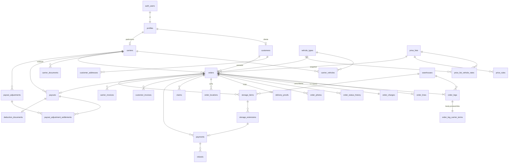

# Transigo — projekt schematu bazy danych

> Status: **ZATWIERDZONY projekt** (2026-11-08) — decyzje W1–W21 jako D18–D37 w [spec.md](spec.md#0-rejestr-decyzji-2026-11-08). Migracje powstają etapami wg sekcji 9; każdą migrację przed utworzeniem pokazuję do akceptacji.
> Źródło wymagań: [spec.md](spec.md). Nazwy w bazie po angielsku, opisy po polsku.

## 1. Konwencje

| Temat | Reguła |
|---|---|
| Klucze | `id uuid primary key default gen_random_uuid()`; wyjątki opisane przy tabeli (np. `profiles.id = auth.users.id`). |
| Czas | `timestamptz` (UTC); daty kalendarzowe (`paid_until`, święta) jako `date`. Każda tabela ma `created_at timestamptz not null default now()`; tabele edytowalne także `updated_at` (trigger). |
| Pieniądze | `*_cents integer` (EUR, centy). Nigdy `float`/`numeric` dla kwot. `check (... >= 0)` tam, gdzie kwota nie może być ujemna. |
| Procenty | `*_bp integer` — punkty bazowe (1 bp = 0,01 %; 22 % IVA = `2200`). Bez ułamków w bazie. |
| Dystans / czas trwania | `distance_m integer` (metry), `duration_s integer` (sekundy) — tak jak zwraca Google. |
| Współrzędne | `lat double precision`, `lng double precision` (to nie pieniądze; float jest OK). |
| Usuwanie | Brak twardego usuwania danych finansowych (zlecenia, płatności, faktury, wypłaty). Archiwizacja przez status / `is_active`. |
| Oznaczenia | 🔒 = pole zmieniane **wyłącznie przez serwer** (service role w route handlerze, webhook, cron lub funkcja `SECURITY DEFINER`). Klient i przewoźnik nigdy nie zapisują go bezpośrednio. |

### 1.1 Jak egzekwujemy „tylko serwer”

1. **Tabele finansowe i statusowe** (`orders`, `order_lines`, `payments`, `refunds`, `customer_invoices`, `payouts`, `payout_adjustments`, …) nie mają polityk `INSERT/UPDATE/DELETE` dla roli `authenticated`. Zapis robi wyłącznie serwer (klient Supabase z service role, tylko w kodzie serwerowym) po własnej walidacji.
2. **Akcje przewoźnika na zleceniu** (przyjęcie kursu, zmiana statusu, POD) idą przez funkcje RPC `SECURITY DEFINER`, które same sprawdzają uprawnienia i dozwolone przejścia statusów. Przykłady: `accept_job(order_id)` i `set_order_status(order_id, status, lat, lng)`.
3. **Kolumny chronione w tabelach edytowanych przez użytkownika** (np. `profiles.role`, `carriers.status`) są zabezpieczone uprawnieniami kolumnowymi (`revoke all` + `grant update (col, …)` dla `authenticated`) oraz triggerem `protect_server_columns(<kolumny>)`, który odrzuca zmianę wykonaną przez `anon`/`authenticated` (service role i SQL Editor mogą). Zablokowane konto: `auth_role()` zwraca `null`, więc nie przechodzi żadna polityka.

### 1.2 Funkcje pomocnicze RLS

- `auth.uid()` — id zalogowanego użytkownika.
- `public.auth_role() returns user_role`: `SECURITY DEFINER`, `stable`, czyta `profiles.role` dla `auth.uid()`. Dzięki temu polityki nie wpadają w rekurencję RLS.
- `public.is_admin() returns boolean`: `auth_role() = 'admin'`.
- `public.is_active_carrier() returns boolean`: rola `padroncino`, `carriers.status = 'active'` i brak przeterminowanych zatwierdzonych dokumentów obowiązkowych.

---

## 2. Enumy

| Enum | Wartości | Uwagi |
|---|---|---|
| `user_role` | `cliente`, `padroncino`, `admin` | `admin` nadawany tylko ręcznie (SQL / service role). |
| `customer_type` | `private`, `business` | D3 — prezentacja cen. |
| `carrier_status` | `pending_review`, `active`, `rejected`, `suspended` | spec 8.1. |
| `carrier_document_type` | `transport_license`, `insurance_rca`, `goods_insurance`, `vehicle_registration`, `identity_document`, `driving_license` | |
| `review_status` | `pending`, `approved`, `rejected` | dokumenty przewoźnika. |
| `order_status` | `draft`, `pending_payment`, `expired`, `paid`, `assigned`, `picked_up`, `in_transit`, `delivered`, `completed`, `cancellation_review`, `cancelled`, `refunded` | spec 4, 4a (D33). |
| `status_source` | `customer_app`, `carrier_app`, `admin_panel`, `stripe_webhook`, `system_job` | skąd przyszła zmiana statusu. |
| `order_line_type` | `transport`, `surcharge_urgent`, `surcharge_weekend_holiday`, `surcharge_floors`, `porters`, `packing`, `storage` | pozycje rozbicia ceny. |
| `carrier_share_group` | `transport`, `porters`, `packing`, `none` | do której reguły D6 należy pozycja (dopłaty → `transport`, D14; magazyn → `none`). |
| `price_rule_code` | `surcharge_urgent`, `surcharge_weekend_holiday`, `surcharge_floor_no_elevator`, `porter_hour`, `porter_overtime_hour` (D68), `packing_flat`, `packing_per_item`, `storage_day`, `storage_pallet_day`, `storage_day_long`, `storage_pallet_day_long`, `transshipment_flat`, `carrier_share_transport`, `carrier_share_porters`, `carrier_share_packing` | lista reguł cennika. |
| `price_rule_kind` | `fixed`, `percent`, `per_unit` | `fixed` = `amount_cents`; `percent` = `percent_bp`; `per_unit` = `amount_cents` × jednostka (piętro, osobogodzina, sztuka, dzień, paleta-dzień). |
| `price_list_status` | `draft`, `active`, `archived` | dokładnie jeden `active`. |
| `storage_type` | `transshipment`, `short_term`, `long_term` | spec 2.4. |
| `storage_billing_unit` | `day`, `pallet_day` | |
| `storage_item_status` | `expected`, `in_storage`, `released` | |
| `payment_purpose` | `order`, `storage_extension` | |
| `payment_status` | `pending`, `succeeded`, `expired`, `failed` | |
| `refund_status` | `pending`, `succeeded`, `failed` | |
| `invoice_kind` | `invoice`, `credit_note` | faktura / nota di credito. |
| `sdi_status` | `queued`, `sent`, `delivered`, `rejected`, `error` | UI: in coda, inviata, consegnata, scartata, errore. |
| `carrier_invoice_status` | `uploaded`, `matched`, `to_verify`, `accepted`, `rejected` | `matched` = automatycznie zgodna; `accepted` = zaakceptowana przez admina po `to_verify`. |
| `payout_status` | `not_ready`, `to_verify`, `waiting_window`, `ready`, `paid_out`, `on_hold`, `failed` | spec 4. |
| `claim_status` | `open`, `closed` | |
| `photo_kind` | `pickup`, `delivery`, `claim` | |
| `notification_channel` | `email`, `sms`, `push` | |
| `out_of_area_reason` | `pickup_province`, `max_distance` | D13. |
| `order_issue_reason` | `vehicle_breakdown`, `cannot_reach_pickup`, `goods_not_as_described`, `address_problem`, `customer_unreachable`, `other` | D39. |
| `order_issue_status` | `open`, `resolved` | D39. |

---

## 3. Tabele

### 3.1 Tożsamość i konta

#### `profiles` — jeden wiersz na użytkownika `auth.users`
| Kolumna | Typ | Uwagi |
|---|---|---|
| `id` | `uuid` PK, FK → `auth.users(id)` on delete cascade | |
| `role` | `user_role` not null | 🔒 Ustawiana przez trigger `on auth.users insert` z `raw_user_meta_data.role`. Dopuszczalne tylko `cliente`/`padroncino`; każda inna wartość, w tym `admin`, daje `cliente`. Na `admin` zmienia się wyłącznie ręcznie (SQL / service role). |
| `first_name` | `text` | |
| `last_name` | `text` | |
| `email` | `text` not null | 🔒 kopia z `auth.users`, synchronizowana triggerem (do list w panelu admina). |
| `phone` | `text` | format E.164. Klient: bez weryfikacji (D34). |
| `is_blocked` | `boolean` not null default false | 🔒 blokada konta przez admina. |
| `terms_accepted_at`, `terms_version` | `timestamptz`, `text` | 🔒 akceptacja „Termini e condizioni” i wersja dokumentu (D42). Oba null albo oba wypełnione. |
| `privacy_accepted_at`, `privacy_version` | `timestamptz`, `text` | 🔒 zgoda Privacy (GDPR) i wersja dokumentu (D42). Oba null albo oba wypełnione. |
| `created_at`, `updated_at` | `timestamptz` | |

Indeksy: `unique(email)`, `(role)`.
**RLS:** użytkownik czyta i edytuje swój wiersz, ale bez kolumn 🔒. Admin czyta wszystko i ustawia `is_blocked`. Wiersz tworzy trigger; nikt nie tworzy go ani nie usuwa ręcznie, a usunięcie konta odbywa się przez serwer.

#### `customers` — dane klienta (1:1 z `profiles` o roli `cliente`)
| Kolumna | Typ | Uwagi |
|---|---|---|
| `profile_id` | `uuid` PK, FK → `profiles` | |
| `customer_type` | `customer_type` not null | wybierany przy rejestracji; zmiana tylko przez admina 🔒 (żeby nie przełączać IVA wstecz). |
| `company_name` | `text` | ragione sociale (wymagane dla `business`). |
| `vat_number` | `text` | P.IVA (wymagane dla `business`). |
| `fiscal_code` | `text` | codice fiscale (`private`: zbierany w „Riepilogo” przed płatnością, nie przy rejestracji — D43). |
| `sdi_code` | `text` | codice destinatario (7 znaków). |
| `pec` | `text` | |
| `billing_street`, `billing_city`, `billing_postal_code`, `billing_province` | `text` | `billing_province` = sigla (np. `MI`). |
| `billing_country` | `char(2)` default `'IT'` | |
| `created_at`, `updated_at` | | |

Check: `business` → `company_name` i `vat_number` not null oraz `sdi_code` lub `pec` not null (D44). Dla `private` brak wymogu w bazie — codice fiscale wymagany przez serwer przed utworzeniem Checkout (D43). Walidacja formatu CF/P.IVA/SDI odbywa się w aplikacji.
**RLS:** klient czyta i edytuje swój wiersz (bez `customer_type`), admin wszystko. Przewoźnik nie ma dostępu.

#### `customer_addresses` — zapisane adresy klienta
`id`, `customer_id` FK → `customers`, `label text`, `address text`, `place_id text`, `lat`, `lng`, `city text`, `postal_code text`, `province char(2)`, `created_at`.
Indeks: `(customer_id)`.
**RLS:** klient pełny CRUD na swoich; admin czyta.

#### `carriers` — dane przewoźnika (1:1 z `profiles` o roli `padroncino`)
| Kolumna | Typ | Uwagi |
|---|---|---|
| `profile_id` | `uuid` PK, FK → `profiles` | |
| `status` | `carrier_status` not null default `pending_review` | 🔒 zmienia admin (przez serwer). |
| `status_reason` | `text` | 🔒 powód odrzucenia / zawieszenia. |
| `activated_at` | `timestamptz` | 🔒 |
| `activated_by` | `uuid` FK → `profiles` | 🔒 |
| `company_name` | `text` not null | ragione sociale |
| `vat_number` | `text` not null | P.IVA |
| `fiscal_code` | `text` | |
| `pec`, `sdi_code` | `text` | |
| `hq_street`, `hq_city`, `hq_postal_code`, `hq_province` | `text` | siedziba |
| `phone_verified_at` | `timestamptz` | 🔒 po weryfikacji SMS (Twilio Verify) — tylko przewoźnicy (D34) |
| `stripe_account_id` | `text` unique | 🔒 konto Connect Express |
| `stripe_details_submitted` | `boolean` not null default false | 🔒 z webhooka `account.updated` |
| `stripe_payouts_enabled` | `boolean` not null default false | 🔒 z webhooka `account.updated` (warunek 5 wypłaty) |
| `created_at`, `updated_at` | | |

Indeksy: `(status)`, `unique(vat_number)`.
**RLS:** przewoźnik czyta swój wiersz i edytuje dane firmowe (bez 🔒). Admin czyta wszystko; status zmienia przez serwer. Klient po przypisaniu widzi tylko imię przewoźnika i dane pojazdu, przez widok `order_carrier_public` (sekcja 4), a nie przez bezpośredni dostęp do tej tabeli.

#### `carrier_vehicles` — pojazdy przewoźnika
| Kolumna | Typ | Uwagi |
|---|---|---|
| `id` | `uuid` PK | |
| `carrier_id` | `uuid` FK → `carriers` | |
| `vehicle_type_id` | `uuid` FK → `vehicle_types` | |
| `plate` | `text` not null | tablica |
| `payload_kg` | `integer` | |
| `cargo_length_cm`, `cargo_width_cm`, `cargo_height_cm` | `integer` | |
| `is_active` | `boolean` not null default true | |
| `approved_at` | `timestamptz` | 🔒 zatwierdzenie przez admina |
| `created_at`, `updated_at` | | |

Indeksy: `(carrier_id)`, `(vehicle_type_id)`, `unique(plate)`.
**RLS:** przewoźnik CRUD na swoich pojazdach (bez `approved_at`; usunięcie tylko jako `is_active = false`). Admin wszystko.

#### `carrier_documents` — dokumenty przewoźnika (pliki w Storage)
| Kolumna | Typ | Uwagi |
|---|---|---|
| `id` | `uuid` PK | |
| `carrier_id` | `uuid` FK → `carriers` | |
| `vehicle_id` | `uuid` FK → `carrier_vehicles`, null | dla `vehicle_registration` |
| `doc_type` | `carrier_document_type` not null | |
| `storage_path` | `text` not null | bucket `carrier-documents` |
| `expires_at` | `date` | data ważności |
| `review_status` | `review_status` not null default `pending` | 🔒 |
| `reviewed_by` | `uuid` FK → `profiles` | 🔒 |
| `reviewed_at` | `timestamptz` | 🔒 |
| `rejection_reason` | `text` | 🔒 |
| `created_at` | | |

Indeksy: `(carrier_id, doc_type)`, `(expires_at)` dla alertów o wygasaniu (30 i 7 dni).
**RLS:** przewoźnik czyta swoje dokumenty i dodaje nowe; po weryfikacji nie może ich edytować, wgrywa nową wersję jako nowy wiersz. Admin czyta wszystko; weryfikację zapisuje serwer.

### 3.2 Konfiguracja (edytowana przez admina)

#### `vehicle_types` — typy pojazdów (D7)
| Kolumna | Typ | Uwagi |
|---|---|---|
| `id` | `uuid` PK | |
| `code` | `text` unique not null | np. `van_small` |
| `name_it` | `text` not null | np. „Furgone piccolo” |
| `payload_kg` | `integer` | |
| `cargo_length_cm`, `cargo_width_cm`, `cargo_height_cm` | `integer` | |
| `cargo_volume_dm3` | `integer` | 3 m³ = 3000 |
| `size_rank` | `smallint` not null unique | kolejność wielkości (1 = najmniejszy). Przewoźnik widzi kursy dla typów o `size_rank` ≤ największego z jego aktywnych pojazdów (D22). |
| `is_active` | `boolean` not null default true | |
| `sort_order` | `integer` not null default 0 | |
| `created_at`, `updated_at` | | |

Stawka/km i cena minimalna są w wersji cennika (`price_list_vehicle_rates`), a nie tutaj, żeby historia cen była wersjonowana. Patrz wątpliwość W1.
**RLS:** odczyt publiczny (`anon` + `authenticated`) aktywnych typów, bo kreator działa bez logowania. Zapis tylko admin.

#### `price_lists` — wersje cennika
| Kolumna | Typ | Uwagi |
|---|---|---|
| `id` | `uuid` PK | |
| `version` | `integer` unique not null | rosnący numer |
| `status` | `price_list_status` not null default `draft` | |
| `vat_rate_bp` | `integer` not null default 2200 | |
| `urgent_lead_hours` | `integer` not null default 24 | D49 |
| `storage_short_term_max_days` | `integer` not null default 30 | D55: próg krótkie/długie (progresja) |
| `storage_billing_unit` | `storage_billing_unit` not null default `pallet_day` | D55 |
| `porter_overtime_grace_minutes` | `integer` not null default 15, check 0–120 | D68 |
| `notes` | `text` | |
| `published_at` | `timestamptz` | |
| `published_by` | `uuid` FK → `profiles` | |
| `created_at`, `updated_at` | | |

Indeks: częściowy `unique (status) where status = 'active'` — gwarantuje jeden aktywny cennik.
Wersji `active` i `archived` nie można edytować (trigger, także dla service role). Zmiana cennika = `clone_price_list(id)` → edycja `draft` → `publish_price_list(id)` (funkcje `SECURITY DEFINER`, tylko admin; publikacja sprawdza kompletność) — D60.
**RLS:** tylko admin (odczyt i zapis `draft`) — D59. Wycenę liczy serwer klientem service role.

#### `price_list_vehicle_rates`
`price_list_id` FK, `vehicle_type_id` FK, `rate_per_km_cents integer not null check >= 0`, `min_price_cents integer not null check >= 0`. PK `(price_list_id, vehicle_type_id)`.
**RLS:** jak `price_lists`.

#### `price_list_porter_packages` — kategorie tragarzy (D67)
`price_list_id` FK (cascade), `code porter_package_code` (`parcels`, `monolocale`, `bilocale`, `trilocale_plus`), `porters_count integer not null check 1–4`, `included_hours integer not null check 1–8`, `is_enabled boolean default true`. PK `(price_list_id, code)`. Edycja tylko w `draft` (ten sam trigger co stawki). `clone_price_list` kopiuje kategorie i uzupełnia brakujące placeholderami (oraz regułę `porter_overtime_hour`); `publish_price_list` wymaga wszystkich 4.
**RLS:** jak `price_lists`.

#### `price_rules` — dopłaty, usługi, magazyn, reguły kwoty przewoźnika
| Kolumna | Typ | Uwagi |
|---|---|---|
| `price_list_id` | `uuid` FK → `price_lists` | |
| `code` | `price_rule_code` | |
| `kind` | `price_rule_kind` not null | |
| `amount_cents` | `integer` | dla `fixed` / `per_unit` |
| `percent_bp` | `integer` | dla `percent` |
| `is_enabled` | `boolean` not null default true | |

PK `(price_list_id, code)`. Check: dokładnie jedno z `amount_cents` / `percent_bp` zgodnie z `kind`; dozwolone `kind` per kod (dopłaty pilne/weekend i `carrier_share_*`: `fixed`/`percent`; `packing_flat`, `transshipment_flat`: `fixed`; reszta: `per_unit`). `carrier_share_*` w procentach ≤ 100 % (D6).
**RLS:** jak `price_lists`.

#### `holidays` — święta włoskie (do dopłaty weekendowej/świątecznej)
`date date` PK, `name_it text`. **RLS:** odczyt publiczny, zapis admin. Patrz W11.

#### `service_area_provinces` — obsługiwane prowincje odbioru (D10, D13)
`province_code char(2)` PK (sigla), `name_it text`, `region_it text`, `is_active boolean` default false. **RLS:** odczyt publiczny aktywnych, admin wszystko (zapis). Na start wszystkie nieaktywne (D61).

#### `settings` — ustawienia globalne (jeden wiersz)
| Kolumna | Typ | Uwagi |
|---|---|---|
| `id` | `boolean` PK default true, check `id` | wymusza jeden wiersz |
| `payout_window_hours` | `integer` not null default 24 | D4 |
| `max_route_distance_m` | `integer` not null default 300000 | D13 (admin wpisuje km, zapisujemy metry) |
| `min_booking_lead_hours` | `integer` not null default 3 | D50 |
| `quote_valid_minutes` | `integer` not null default 30 | D62 |
| `gps_interval_s` | `integer` not null default 15 | D17 |
| `unassigned_alert_hours` | `integer` not null default 4 | dashboard: `paid` bez przewoźnika |
| `free_cancellation_hours` | `integer` not null default 24 | D33: bezpłatne anulowanie do X h przed `pickup_window_start` |
| `late_cancellation_fee_bp` | `integer` not null default 5000 check 0–10000 | D33: opłata Y % (50 %) przy późnym anulowaniu |
| `company_name`, `company_vat_number`, `company_fiscal_code`, `company_street`, `company_city`, `company_postal_code`, `company_province`, `company_pec`, `company_sdi_code`, `company_email`, `company_phone` | `text` | dane Transigo do faktur |
| `terms_version`, `privacy_version` | `text` not null default `'2026-11-01'` | aktualne wersje „Termini” i „Privacy” zapisywane przy zgodzie (D42) |
| `updated_at`, `updated_by` | | |

**RLS:** odczyt tylko admin. Wartości potrzebne publicznie, np. dane firmy w stopce, serwer podaje osobno. Zapis tylko admin.

#### `message_templates` — szablony e-mail / SMS
`code text`, `channel notification_channel`, `subject_it text`, `body_it text`, `updated_at`. PK `(code, channel)`. **RLS:** tylko admin.

#### `out_of_area_requests` — zapytania spoza obszaru obsługi
`id`, `name text`, `email text`, `phone text`, `pickup_address text`, `delivery_address text`, `distance_m integer`, `reason out_of_area_reason`, `message text`, `handled_at timestamptz`, `handled_by uuid`, `created_at`.
**RLS:** brak bezpośredniego zapisu z przeglądarki. Formularz wysyła dane do route handlera (walidacja + rate limit + e-mail do admina), a ten zapisuje przez serwer. Odczyt i obsługa: admin.

#### `quotes` — wyceny kreatora (D76)
`id uuid` PK, `price_list_id uuid` FK → `price_lists` on delete cascade, `customer_type customer_type not null`, `input jsonb not null` (dane kreatora + miejsca i trasy rozwiązane przez serwer), `quote jsonb not null` (pełny `Quote`, z kwotami przewoźnika), `created_at`, `valid_until timestamptz not null` (`created_at + settings.quote_valid_minutes`).
Indeks: `(created_at)` do czyszczenia (> 24 h usuwa serwer).
**RLS:** włączone, bez polityk; rolom `anon`/`authenticated` odebrane wszystkie uprawnienia — tylko service role. Przeglądarka zna tylko `id`.

### 3.3 Zlecenia

> **Model zleceń wg D77 (Etap 2b).** RLS działa na wiersze, więc dane zlecenia są podzielone wg tego, kto je widzi: wspólne (`orders`, `order_legs`, `order_status_history`), cena klienta (`order_charges`, `order_lines`) i kwoty przewoźnika (`order_leg_carrier_terms`). Zlecenie tworzy wyłącznie `create_order(jsonb)` (sekcja 4) — rolom API (`anon`, `authenticated`, `service_role`) odebrano `INSERT` na wszystkich tych tabelach oraz `UPDATE/DELETE` na tabelach podrzędnych.

#### `orders` — dane wspólne (klient, przypisany przewoźnik, admin)
| Kolumna | Typ | Uwagi |
|---|---|---|
| `id` | `uuid` PK | |
| `order_number` | `text` unique not null | 🔒 `TG-RRRR-NNNNNN` (D71), trigger przy wstawieniu, niezmienny |
| `customer_id` | `uuid` FK → `customers` not null, on delete restrict | niezmienny (D77) |
| `status` | `order_status` not null default `pending_payment` | 🔒 (D77: w 2b zapis od razu jako `pending_payment`) |
| `vehicle_type_id` | `uuid` FK → `vehicle_types` not null | ten sam typ dla wszystkich odcinków |
| `pickup_window_start` | `timestamptz` not null | 🔒 kopia z odcinka 0 (punkt odniesienia D33), ustawia `create_order` |
| **Towar** | | |
| `goods_description` | `text` not null | |
| `items_count`, `weight_kg` | `integer` check > 0 | orientacyjnie |
| `goods_dimensions_note` | `text` | |
| **Usługi** | | tragarze per odcinek — w `order_legs` (D74) |
| `packing_items_count` | `integer` not null default 0 | 0 = bez pakowania |
| `storage_type` | `storage_type` | null = bez magazynu |
| `storage_billing_unit` | `storage_billing_unit` | |
| `storage_days` | `integer` check ≥ 0 | 0 = transbordo |
| `storage_pallets` | `integer` check > 0 | wymagane przy `pallet_day` |
| `warehouse_id` | `uuid` FK → `warehouses` | wymagane, gdy jest magazyn (D72) |
| **Kontakty** | | |
| `pickup_contact_name`, `pickup_contact_phone`, `delivery_contact_name`, `delivery_contact_phone` | `text` not null | odbiór w A / dostawa do B |
| `customer_notes` | `text` | |
| **Realizacja** | | |
| `carrier_id` | `uuid` FK → `carriers`, null, on delete restrict | 🔒 przypisanie per zlecenie (D75) |
| `carrier_vehicle_id` | `uuid` FK → `carrier_vehicles`, null | 🔒 |
| `paid_at`, `assigned_at`, `picked_up_at`, `in_transit_at`, `delivered_at`, `completed_at`, `cancelled_at` | `timestamptz` | 🔒 (`paid_at` tylko z webhooka Stripe) |
| `tracking_token` | `text` unique | 🔒 (D24) |
| `created_at`, `updated_at` | | |

Kolumny anulowania (`cancel_reason`, `cancellation_requested_*`, `cancellation_decided_*`, `cancellation_fee_cents` → `order_charges`, `cancellation_carrier_amount_cents` → tabela przewoźnika) dochodzą z funkcją anulowania w Etapie 3 (D77).
Indeksy: `(customer_id, created_at desc)`, `(carrier_id, status)`, `(status, pickup_window_start)`.
Checki: magazyn — `storage_type`, `storage_billing_unit`, `storage_days`, `warehouse_id` wszystkie albo żadne, `storage_pallets` przy `pallet_day`; `paid_at is not null` gdy status ∈ {`paid` … `completed`}; `carrier_id is not null` gdy status ∈ {`assigned`, `picked_up`, `in_transit`, `delivered`, `completed`, `cancellation_review`}. Liczba odcinków (1 bez magazynu, 2 z magazynem) — sprawdza `create_order`.
Triggery: `order_number`; `order_number`, `customer_id`, `created_at` niezmienne; `DELETE` tylko dla `draft`/`pending_payment`/`expired` (także service role) — kaskadowo usuwa tabele podrzędne.
**RLS:** cliente `select` swoich (`customer_id = auth.uid()`); padroncino `select` przypisanych (`carrier_id = auth.uid()`; kursy dostępne tylko przez `available_jobs()`, Etap 4); admin `select` wszystkiego. Brak zapisu z przeglądarki; zmiany statusu robi serwer / RPC.

#### `order_legs` — odcinki zlecenia (D47; dane wspólne)
| Kolumna | Typ | Uwagi |
|---|---|---|
| `order_id` | `uuid` FK → `orders` on delete cascade | |
| `leg_index` | `smallint` check 0–1 | PK `(order_id, leg_index)` |
| `pickup_address`, `delivery_address` | `text` not null | pełny adres (strona magazynu: adres magazynu) |
| `pickup_place_id`, `delivery_place_id` | `text` | |
| `pickup_lat`, `pickup_lng`, `delivery_lat`, `delivery_lng` | `double precision` not null | |
| `pickup_city`, `delivery_city` | `text` not null | do zanonimizowanej listy kursów |
| `pickup_postal_code`, `delivery_postal_code` | `text` | |
| `pickup_province` | `char(2)` not null | w obszarze obsługi (D13, D61; sprawdza serwer) |
| `delivery_province` | `char(2)` | |
| `pickup_warehouse_id`, `delivery_warehouse_id` | `uuid` FK → `warehouses`, null | która strona odcinka to magazyn |
| `distance_m`, `duration_s` | `integer` | 🔒 z Google Routes (serwer); `distance_m` not null > 0 |
| `pickup_date` | `date` not null | data okna w Europe/Rome |
| `pickup_window_start`, `pickup_window_end` | `timestamptz` not null | D73, `end > start` |
| `pickup_floor`, `delivery_floor` | `smallint` not null default 0, 0–20 | D53 |
| `pickup_has_elevator`, `delivery_has_elevator` | `boolean` not null default false | |
| `is_urgent` | `boolean` not null | 🔒 z silnika (D49) |
| `porter_package_code` | `porter_package_code` | null = bez tragarzy na tym odcinku (D74) |
| `porters_count` | `smallint` not null default 0, 0–4 | |
| `porters_included_hours` | `smallint` 1–8 | snapshot `Quote.porters[]` (D68) |
| `porter_overtime_grace_minutes` | `smallint` 0–120 | snapshot (D68) |
| `porters_worked_minutes` | `integer` ≥ 0 | Etap 4 (D69) — jedyne pole zmienne |

Check: kolumny tragarzy wszystkie albo żadne (`porters_count ≥ 1` przy kategorii). Stawka nadgodzin to cena klienta → `order_charges`; udział przewoźnika → `order_leg_carrier_terms`.
**RLS:** jak `orders` (przez istnienie widocznego zlecenia). Wszystkie pola 🔒 i niezmienne poza `porters_worked_minutes`.

#### `order_charges` — cena klienta (1:1, klient + admin)
| Kolumna | Typ | Uwagi |
|---|---|---|
| `order_id` | `uuid` PK FK → `orders` on delete cascade | |
| `price_list_id` | `uuid` FK → `price_lists` not null, restrict | 🔒 wersja cennika |
| `price_list_version` | `integer` not null | 🔒 |
| `customer_type` | `customer_type` not null | 🔒 snapshot (D3) |
| `vat_rate_bp` | `integer` not null | 🔒 |
| `subtotal_cents`, `vat_cents`, `total_cents` | `integer` not null ≥ 0, `total = subtotal + vat` | 🔒 `total` = kwota w Stripe |
| `porter_overtime_rate_cents` | `integer` ≥ 0 | 🔒 cena za osobę za rozpoczętą godzinę (D68); null = bez tragarzy lub reguła wyłączona |
| `refunded_cents` | `integer` not null default 0, ≤ `total` | 🔒 jedyne pole zmienne (Etap 3) |
| `billing_details` | `jsonb` not null | 🔒 snapshot danych do faktury (D36, D43, D44) |
| `terms_accepted_at`, `terms_version` | `timestamptz`, `text` not null | |
| `quoted_at` | `timestamptz` not null | czas wyceny użytej w zleceniu |
| `created_at`, `updated_at` | | |

**RLS:** cliente `select` swoich, admin wszystko; przewoźnik **brak** (D29).

#### `order_lines` — rozbicie ceny klienta (snapshot; klient + admin)
| Kolumna | Typ | Uwagi |
|---|---|---|
| `id` | `uuid` PK | |
| `order_id` | `uuid` FK → `orders` on delete cascade | |
| `sort_order` | `smallint` not null | unique `(order_id, sort_order)` |
| `leg_index` | `smallint` | null = magazyn |
| `line_type` | `order_line_type` not null | |
| `label_it` | `text` not null | tekst na fakturze / w podsumowaniu |
| `quantity` | `integer` not null > 0 | km, piętra, osobogodziny, dni… |
| `unit_amount_cents` | `integer` ≥ 0 | |
| `net_cents`, `vat_cents`, `gross_cents` | `integer` not null ≥ 0, `gross = net + vat` | IVA per pozycja (D56) |
| `carrier_share_group` | `carrier_share_group` not null | |

Wszystkie pola 🔒, niezmienne. `create_order` sprawdza, że sumy pozycji = `order_charges`.
**RLS:** cliente czyta pozycje swoich zleceń, admin wszystko; przewoźnik **brak** (D29 zastępuje W13 — kwoty przewoźnika są w `order_leg_carrier_terms`).

#### `order_leg_carrier_terms` — kwoty przewoźnika per odcinek (przewoźnik + admin)
| Kolumna | Typ | Uwagi |
|---|---|---|
| `order_id`, `leg_index` | PK, FK → `order_legs` on delete cascade | |
| `carrier_amount_cents` | `integer` not null ≥ 0 | = transport + tragarze + pakowanie odcinka |
| `transport_carrier_cents`, `porters_carrier_cents`, `packing_carrier_cents` | `integer` not null default 0 ≥ 0 | grupy D57 |
| `porter_share_kind` | `text` (`percent` / `ratio`) | udział dla nadgodzin (D68); null = bez tragarzy lub udział wyłączony |
| `porter_share_bp` | `integer` | dla `percent` |
| `porter_share_carrier_cents`, `porter_share_net_cents` | `integer` | dla `ratio` (reguła `fixed`) |

Kwota przewoźnika za zlecenie = suma po odcinkach. Wszystkie pola 🔒, niezmienne.
**RLS:** padroncino czyta wiersze przypisanych zleceń, admin wszystko; klient **brak**.

#### `order_status_history`
| Kolumna | Typ | Uwagi |
|---|---|---|
| `id` | `bigint` identity PK | |
| `order_id` | `uuid` FK → `orders` on delete cascade | |
| `from_status` | `order_status` | null przy utworzeniu |
| `to_status` | `order_status` not null | |
| `changed_by` | `uuid` FK → `profiles`, null, on delete set null | null = system / webhook |
| `source` | `status_source` not null | |
| `note` | `text` | widoczna dla stron zlecenia; wewnętrzne powody admina → `audit_log` (D77) |
| `lat`, `lng` | `double precision` | GPS przy zmianie przez przewoźnika |
| `created_at` | `timestamptz` | |

Indeks: `(order_id, created_at)`. Append-only (trigger odrzuca `UPDATE`, rolom API odebrano `INSERT/UPDATE/DELETE`; wpisy dodają funkcje `SECURITY DEFINER`).
**RLS:** jak `orders`.

#### `order_internal_notes` — notatki wewnętrzne admina
`id`, `order_id` FK, `author_id` FK → `profiles`, `body text`, `created_at`. **RLS:** tylko admin.

#### `order_photos` — zdjęcia ładunku / dostawy / reklamacji
`id`, `order_id` FK, `kind photo_kind`, `claim_id uuid` FK null, `storage_path text`, `uploaded_by uuid`, `lat`, `lng`, `taken_at timestamptz`, `created_at`.
Indeks: `(order_id, kind)`.
**RLS:** przewoźnik dodaje zdjęcia `pickup`/`delivery` tylko do swojego zlecenia w statusie `assigned`…`in_transit` i czyta je. Klient czyta zdjęcia swoich zleceń i dodaje zdjęcia `claim` do swoich reklamacji. Admin wszystko.

#### `delivery_proofs` — POD (1:1 ze zleceniem)
`order_id uuid` PK FK, `recipient_name text not null`, `signature_path text not null`, `lat`, `lng`, `signed_at timestamptz not null`, `created_by uuid`.
Zapis przez RPC `complete_delivery(...)`, które w jednej transakcji zapisuje POD, sprawdza, że jest ≥ 1 zdjęcie `delivery`, ustawia status `delivered` i tworzy wiersz `payouts`.
**RLS:** przewoźnik (przez RPC) zapisuje POD dla swojego zlecenia i czyta go; klient czyta POD swoich zleceń; admin wszystko.

#### `order_locations` — punkty GPS w trakcie kursu
| Kolumna | Typ | Uwagi |
|---|---|---|
| `id` | `bigint` identity PK | |
| `order_id` | `uuid` FK → `orders` | |
| `carrier_id` | `uuid` FK → `carriers` | |
| `lat`, `lng` | `double precision` not null | |
| `accuracy_m` | `integer` | |
| `heading_deg`, `speed_kmh` | `smallint` | |
| `recorded_at` | `timestamptz` not null | |

Indeks: `(order_id, recorded_at desc)`. Tabela dodana do Supabase Realtime (mapa klienta).
**RLS:** przewoźnik `insert` tylko dla swojego zlecenia w statusie `picked_up` / `in_transit`. Klient `select` swoich zleceń, tylko od `picked_up` do `delivered`. Admin `select`. Retencja patrz W9.

#### `claims` — reklamacje
`id`, `order_id` FK, `opened_by uuid` FK → `profiles`, `status claim_status default 'open'` 🔒, `description text not null`, `resolution_note text` 🔒, `closed_by uuid` 🔒, `closed_at` 🔒, `created_at`, `updated_at`.
Indeks: `(order_id, status)`. Otwarcie reklamacji przestawia wypłatę na `on_hold` (logika serwera / trigger).
**RLS:** klient tworzy i czyta reklamacje swoich zleceń, admin wszystko i jako jedyny zamyka. Przewoźnik widzi, że do jego zlecenia jest otwarta reklamacja (status + opis), ale nie dane klienta; patrz W14.

#### `order_issues` — zgłoszenia problemów przez przewoźnika (D39, Etap 4)
| Kolumna | Typ | Uwagi |
|---|---|---|
| `id` | `uuid` PK | |
| `order_id` | `uuid` FK → `orders` | |
| `carrier_id` | `uuid` FK → `carriers` | |
| `reason` | `order_issue_reason` not null | |
| `description` | `text` not null | |
| `status` | `order_issue_status` not null default `open` | 🔒 |
| `resolution_note` | `text` | 🔒 |
| `resolved_by`, `resolved_at` | | 🔒 |
| `created_at`, `updated_at` | | |

Indeksy: `(order_id)`, `(status, created_at)` dla kolejki admina. Po zapisie serwer wysyła e-mail do admina.
**RLS:** przewoźnik `insert` i `select` zgłoszeń dla zleceń przypisanych do niego (statusy `assigned`…`delivered`); admin wszystko (rozwiązanie przez serwer); klient brak.

### 3.4 Płatności i faktury klienta

#### `payments` — płatności Stripe (zlecenie albo przedłużenie magazynu)
| Kolumna | Typ | Uwagi |
|---|---|---|
| `id` | `uuid` PK | |
| `purpose` | `payment_purpose` not null | |
| `order_id` | `uuid` FK → `orders` not null | |
| `storage_extension_id` | `uuid` FK → `storage_extensions`, null | dla `storage_extension` |
| `amount_cents` | `integer` not null check > 0 | 🔒 |
| `status` | `payment_status` not null | 🔒 tylko webhook |
| `stripe_checkout_session_id` | `text` unique | 🔒 |
| `stripe_payment_intent_id` | `text` unique | 🔒 |
| `paid_at` | `timestamptz` | 🔒 |
| `created_at`, `updated_at` | | |

Indeks: `(order_id)`. Wszystkie pola 🔒.
**RLS:** klient czyta płatności swoich zleceń; admin wszystko; przewoźnik brak.

#### `refunds` — zwroty
| Kolumna | Typ | Uwagi |
|---|---|---|
| `id` | `uuid` PK | |
| `order_id`, `payment_id` | `uuid` FK | |
| `amount_cents` | `integer` not null check > 0 | 🔒 suma zwrotów ≤ kwota płatności (sprawdza serwer + trigger) |
| `reason` | `text` not null | |
| `status` | `refund_status` | 🔒 |
| `stripe_refund_id` | `text` unique | 🔒 |
| `after_payout` | `boolean` not null default false | 🔒 zwrot po wypłacie → koszt Transigo (D5) |
| `credit_note_id` | `uuid` FK → `customer_invoices` | 🔒 |
| `created_by` | `uuid` FK → `profiles` | admin |
| `created_at`, `updated_at` | | |

**RLS:** klient czyta zwroty swoich zleceń, bez `reason` z panelu admina (przez widok). Admin wszystko. Zapis wyłącznie przez serwer.

#### `stripe_events` — idempotencja webhooków
`event_id text` PK, `type text`, `account text` (dla eventów Connect), `received_at`, `processed_at`, `error text`.
**RLS:** brak dostępu dla `authenticated`; tylko service role. Admin czyta przez serwer.

#### `customer_invoices` — e-faktury i noty korygujące dla klienta (SDI)
| Kolumna | Typ | Uwagi |
|---|---|---|
| `id` | `uuid` PK | |
| `kind` | `invoice_kind` not null | |
| `order_id` | `uuid` FK → `orders` not null | |
| `payment_id` | `uuid` FK → `payments` | |
| `refund_id` | `uuid` FK → `refunds` | dla noty korygującej |
| `corrects_invoice_id` | `uuid` FK → `customer_invoices` | nota → faktura pierwotna |
| `provider` | `text` not null | np. `fatture_in_cloud` (adapter) |
| `provider_document_id` | `text` | |
| `number` | `text` | numer nadany przez dostawcę |
| `issue_date` | `date` | |
| `net_cents`, `vat_cents`, `total_cents` | `integer` not null | |
| `sdi_status` | `sdi_status` not null default `queued` | |
| `last_error` | `text` | |
| `attempts` | `smallint` not null default 0 | |
| `next_retry_at` | `timestamptz` | kolejka ponowień |
| `pdf_path` | `text` | bucket `invoices` |
| `created_at`, `updated_at` | | |

Wszystkie pola 🔒. Indeksy: `(order_id)`, `(sdi_status, next_retry_at)`, `unique(provider, provider_document_id)`.
**RLS:** klient czyta faktury swoich zleceń (bez `last_error`, przez widok). Admin wszystko. Przewoźnik brak.

### 3.5 Przewoźnik: faktury i wypłaty

#### `carrier_invoices` — faktury przewoźnika dla Transigo
| Kolumna | Typ | Uwagi |
|---|---|---|
| `id` | `uuid` PK | |
| `order_id` | `uuid` FK → `orders` | |
| `carrier_id` | `uuid` FK → `carriers` | |
| `storage_path` | `text` not null | PDF / XML w buckecie `carrier-invoices` |
| `file_type` | `text` check in (`pdf`,`xml`) | |
| `invoice_number` | `text` not null | |
| `invoice_date` | `date` not null | |
| `declared_amount_cents` | `integer` not null check ≥ 0 | kwota wpisana przez przewoźnika |
| `status` | `carrier_invoice_status` not null default `uploaded` | 🔒 walidacja automatyczna: `= orders.carrier_amount_cents` → `matched`, inaczej `to_verify` (D12) |
| `review_note` | `text` | 🔒 |
| `reviewed_by`, `reviewed_at` | | 🔒 |
| `created_at` | | |

Indeksy: `(order_id)`, `(carrier_id)`, częściowy `unique(order_id) where status <> 'rejected'` (jedna ważna faktura na zlecenie; po odrzuceniu można wgrać nową).
**RLS:** przewoźnik `insert` dla swojego zlecenia w statusie `delivered` (pola bez 🔒) i `select` swoich faktur. Admin wszystko. Klient brak.

#### `payouts` — wypłata za zlecenie (1:1 ze zleceniem po dostawie)
| Kolumna | Typ | Uwagi |
|---|---|---|
| `id` | `uuid` PK | |
| `order_id` | `uuid` FK → `orders` unique | |
| `carrier_id` | `uuid` FK → `carriers` | |
| `status` | `payout_status` not null default `not_ready` | 🔒 |
| `carrier_amount_cents` | `integer` not null check ≥ 0 | 🔒 = `orders.carrier_amount_cents` (kwota faktury); dla zlecenia anulowanego w `cancellation_review` = `cancellation_carrier_amount_cents` (patrz A3) |
| `adjustments_cents` | `integer` not null default 0 check ≤ 0 | 🔒 potrącenia rozliczone w tej wypłacie |
| `transfer_amount_cents` | `integer` check ≥ 0 | 🔒 = kwota + potrącenia, min. 0 (D15) |
| `eligible_at` | `timestamptz` | 🔒 `delivered_at + payout_window_hours` |
| `hold_reason` | `text` | 🔒 |
| `held_by`, `held_at` | | 🔒 |
| `stripe_transfer_id` | `text` unique | 🔒 |
| `idempotency_key` | `text` unique not null | 🔒 np. `payout:<order_id>:<attempt>` |
| `attempts` | `smallint` not null default 0 | 🔒 |
| `failure_reason` | `text` | 🔒 |
| `paid_out_at` | `timestamptz` | 🔒 |
| `created_at`, `updated_at` | | |

Wszystkie pola 🔒. Indeksy: `(status, eligible_at)` dla crona co 15 min (D16), `(carrier_id, created_at desc)`.
**RLS:** przewoźnik czyta swoje wypłaty, w tym status `on_hold` i powód (W15). Admin wszystko. Klient brak.

#### `payout_adjustments` — potrącenia (D5, D12, D15)
| Kolumna | Typ | Uwagi |
|---|---|---|
| `id` | `uuid` PK | |
| `carrier_id` | `uuid` FK → `carriers` | |
| `order_id` | `uuid` FK → `orders`, null | zlecenie, którego dotyczy potrącenie |
| `refund_id` | `uuid` FK → `refunds`, null | |
| `amount_cents` | `integer` not null check < 0 | 🔒 potrącenie (ujemne) |
| `reason` | `text` not null | |
| `created_by` | `uuid` FK → `profiles` | admin |
| `created_at` | | |

**RLS:** przewoźnik czyta swoje potrącenia; admin wszystko. Zapis wyłącznie przez serwer.

#### `payout_adjustment_settlements` — rozliczenie potrącenia w konkretnej wypłacie
`adjustment_id` FK, `payout_id` FK, `amount_cents integer not null check < 0`, `created_at`. PK `(adjustment_id, payout_id)`.
Dzięki tej tabeli potrącenie większe niż wypłata można rozbić na kilka wypłat (D15). Pozostało do rozliczenia = `adjustment.amount_cents − Σ settlements.amount_cents`. Wszystkie pola 🔒.
**RLS:** jak `payout_adjustments`.

#### `deduction_documents` — dokument potrącenia (D12, rodzaj **[DO POTWIERDZENIA Z COMMERCIALISTA]**)
`id`, `payout_id` FK unique, `carrier_id` FK, `total_cents integer not null check < 0`, `document_number text`, `pdf_path text`, `created_at`. Wszystkie pola 🔒.
**RLS:** przewoźnik czyta swoje; admin wszystko.

### 3.6 Magazyn (D9)

#### `warehouses` (tworzona w Etapie 2b — D72)
`id`, `name text not null`, `address text not null` (pełny adres z Google), `street`, `city text not null`, `postal_code`, `province char(2) not null`, `place_id text`, `lat`, `lng double precision not null`, `is_active boolean not null default false`, `created_at`, `updated_at`.
Indeks częściowy `unique (is_active) where is_active` — w MVP najwyżej jeden aktywny magazyn (do usunięcia przy kolejnych magazynach).
**RLS:** admin CRUD; reszta brak (adres magazynu w kreatorze podaje serwer).

#### `storage_items` — pozycja składowana
| Kolumna | Typ | Uwagi |
|---|---|---|
| `id` | `uuid` PK | |
| `order_id` | `uuid` FK → `orders` | |
| `customer_id` | `uuid` FK → `customers` | |
| `warehouse_id` | `uuid` FK → `warehouses` | |
| `storage_type` | `storage_type` not null | |
| `billing_unit` | `storage_billing_unit` not null | |
| `pallets_count` | `integer` | |
| `location_code` | `text` | miejsce w magazynie |
| `status` | `storage_item_status` not null default `expected` | |
| `checked_in_at`, `checked_out_at` | `timestamptz` | |
| `paid_until` | `date` not null | 🔒 przesuwane tylko po webhooku płatności |
| `created_at`, `updated_at` | | |

Indeksy: `(customer_id)`, `(warehouse_id, status)`, `(paid_until)` dla alertów o kończącym się okresie.
**RLS:** klient czyta swoje pozycje (bez `location_code`). Admin wszystko i edytuje pola operacyjne (przyjęcie, wydanie, lokalizacja). `paid_until` zmienia tylko serwer.

#### `storage_extensions` — przedłużenie składowania
`id`, `storage_item_id` FK, `days integer not null check > 0`, `amount_cents integer not null` 🔒, `new_paid_until date` 🔒, `stripe_payment_link_url text` 🔒, `status payment_status` 🔒, `created_by uuid`, `created_at`, `updated_at`.
Płatność trafia do `payments` (`purpose = storage_extension`). Fakturę wystawia ten sam mechanizm co dla zlecenia.
**RLS:** klient czyta przedłużenia swoich pozycji; admin wszystko; zapis tylko serwer.

### 3.7 Powiadomienia i audyt

#### `notification_log`
`id bigint identity`, `recipient_id uuid` FK null, `recipient_address text` (e-mail / telefon), `channel notification_channel`, `template_code text`, `order_id uuid` null, `status text` (`sent`/`failed`), `provider_message_id text`, `error text`, `created_at`.
**RLS:** tylko admin (odczyt); zapis serwer.

#### `audit_log` — działania admina i zdarzenia systemowe
`id bigint identity`, `actor_id uuid` null (bez FK — przetrwa usunięcie konta, D65), `actor_email text` (snapshot), `action text` (np. `payout.hold`, `carrier.activate`, `order.refund`), `entity_type text`, `entity_id uuid`, `data jsonb`, `created_at`.
Indeks: `(entity_type, entity_id, created_at)`.
**RLS:** tylko admin (odczyt); zapis serwer. Append-only: trigger odrzuca UPDATE/DELETE/TRUNCATE, także dla service role (D65). W `data` tylko ID i wartości biznesowe, bez danych osobowych klientów.

---

## 4. Widoki i funkcje RPC (dostęp kontrolowany)

| Obiekt | Typ | Kto | Co robi |
|---|---|---|---|
| `create_order(payload jsonb)` | funkcja `SECURITY DEFINER` | tylko `service_role` (serwer) | W jednej transakcji tworzy `orders`, `order_legs`, `order_charges`, `order_lines`, `order_leg_carrier_terms` i wpis historii `→ pending_payment` (`customer_app`). Sprawdza: 1–2 odcinki z kolejnymi indeksami, magazyn ⇔ 2 odcinki, sumy pozycji = sumy `order_charges`, `total = subtotal + vat`, tragarze odcinka ⇔ pozycja `porters` tego odcinka, `carrier_amount = suma grup`. Zwraca `id` i `order_number` (D77). |
| `available_jobs()` | funkcja `SECURITY DEFINER` → tabela | aktywny przewoźnik | Zwraca zlecenia `paid` bez przewoźnika, których typ pojazdu ma `size_rank` ≤ największego `size_rank` wśród jego aktywnych, zatwierdzonych pojazdów (D22). Kwota = `carrier_amount_cents` zlecenia (wg typu ze zlecenia, nie pojazdu przewoźnika). Pola: `id`, miasto i prowincja odbioru/dostawy, data i okno, `distance_m`, typ pojazdu, flagi usług extra (piętra, tragarze, pakowanie), `carrier_amount_cents`. **Bez** adresów, nazwisk, telefonów i cen klienta. |
| `accept_job(order_id)` | funkcja `SECURITY DEFINER` | aktywny przewoźnik | Atomowo: `update orders set carrier_id = auth.uid(), status = 'assigned' … where id = $1 and status = 'paid' and carrier_id is null returning …`. 0 wierszy → „Corsa già assegnata”. Zapisuje historię statusu. |
| `set_order_status(order_id, to_status, lat, lng)` | funkcja `SECURITY DEFINER` | przypisany przewoźnik | Tylko przejścia `assigned→picked_up` (wymaga zdjęcia `pickup`) i `picked_up→in_transit`. |
| `complete_delivery(order_id, recipient_name, signature_path, lat, lng)` | funkcja `SECURITY DEFINER` | przypisany przewoźnik | `in_transit→delivered` + POD + utworzenie `payouts` (`not_ready`). |
| `order_carrier_public` | widok | klient (swoje zlecenia) | Po przypisaniu: imię przewoźnika, typ pojazdu, tablica. |
| `tracking_by_token(token)` | funkcja `SECURITY DEFINER` | `anon` | Tylko jeśli W8 = tak: status + ostatnia pozycja, bez danych osobowych. |

Funkcje `SECURITY DEFINER` mają `set search_path = ''` i same sprawdzają `auth.uid()` i rolę.

## 5. Supabase Storage (prywatne buckety, dostęp przez signed URL)

| Bucket | Ścieżka | Kto wgrywa | Kto czyta |
|---|---|---|---|
| `carrier-documents` | `{carrier_id}/{document_id}.{ext}` | przewoźnik (swój folder) | przewoźnik (swój), admin |
| `order-photos` | `{order_id}/{photo_id}.jpg` | przewoźnik przypisany do zlecenia; klient (zdjęcia reklamacji) | klient zlecenia, przewoźnik przypisany, admin |
| `signatures` | `{order_id}.png` | przewoźnik przypisany | klient zlecenia, przewoźnik przypisany, admin |
| `carrier-invoices` | `{carrier_id}/{order_id}/{invoice_id}.{pdf\|xml}` | przewoźnik (swój folder) | przewoźnik (swój), admin |
| `invoices` | `{order_id}/{invoice_id}.pdf` | serwer | klient zlecenia, admin |
| `deduction-documents` | `{carrier_id}/{document_id}.pdf` | serwer | przewoźnik (swój), admin |

## 6. Podsumowanie RLS (macierz)

R = odczyt, W = zapis bezpośredni z aplikacji (z RLS), S = zapis tylko przez serwer/RPC, „—” = brak dostępu. „własne” = powiązane z `auth.uid()`.

| Tabela | cliente | padroncino | admin |
|---|---|---|---|
| `profiles` | R/W własny (bez 🔒) | R/W własny (bez 🔒) | R, S |
| `customers` | R/W własny (bez typu) | — | R, S |
| `customer_addresses` | R/W własne | — | R |
| `carriers` | — (tylko widok publiczny po przypisaniu) | R/W własny (bez 🔒) | R, S |
| `carrier_vehicles` | — | R/W własne (bez `approved_at`) | R, S |
| `carrier_documents` | — | R + insert własne | R, S |
| `vehicle_types`, `service_area_provinces`, `holidays` | R (także `anon`) | R | R/W |
| `price_lists`, `price_list_vehicle_rates`, `price_rules`, `price_list_porter_packages` | — | — | R/W (draft) — D59 |
| `settings`, `message_templates` | — | — | R/W |
| `out_of_area_requests` | — (S przez formularz) | — | R/W |
| `orders`, `order_legs` | R własne, S | R przypisane, S (RPC) | R, S |
| `order_charges`, `order_lines` | R własne | — (D29) | R |
| `order_leg_carrier_terms` | — | R przypisane | R |
| `order_status_history` | R własne | R przypisane | R |
| `quotes` | — | — | — (tylko service role) |
| `order_internal_notes` | — | — | R/W |
| `order_photos` | R własne, W `claim` | R/W przypisane (`pickup`/`delivery`) | R/W |
| `delivery_proofs` | R własne | R, S (RPC) | R |
| `order_locations` | R własne (picked_up…delivered) | W przypisane (w trakcie kursu) | R |
| `claims` | R + insert własne | R przypisane (W14) | R, S |
| `order_issues` | — | R + insert przypisane | R, S |
| `payments`, `refunds` | R własne | — | R, S |
| `stripe_events` | — | — | — (tylko service role) |
| `customer_invoices` | R własne | — | R, S |
| `carrier_invoices` | — | R + insert własne | R, S |
| `payouts`, `payout_adjustments`, `payout_adjustment_settlements`, `deduction_documents` | — | R własne | R, S |
| `warehouses` | — | — | R/W (od 2b, D72) |
| `storage_items` | R własne | — | R/W (bez `paid_until`) |
| `storage_extensions` | R własne | — | R, S |
| `notification_log`, `audit_log` | — | — | R |

Zablokowany użytkownik (`profiles.is_blocked`) nie przechodzi przez żadną politykę, bo każda polityka sprawdza `not is_blocked`. Proxy dodatkowo go wylogowuje.

## 7. Diagram relacji

## 8. Decyzje i otwarte pytania

Propozycje W1–W21 zatwierdzone 2026-11-08 jako decyzje **D18–D37** (rejestr w [spec.md](spec.md#0-rejestr-decyzji-2026-11-08)). Zmiany względem propozycji: W6 → D22 (także typy mniejsze, `size_rank`), W17 → D33 (polityka anulowania w MVP), W18 → D34 (SMS tylko dla przewoźników).

Pytania A1–A4 rozstrzygnięte 2026-11-08 jako **D38–D41** (A2 rozszerzone o zgłoszenia „Segnala un problema” → tabela `order_issues`, Etap 4).

## 9. Plan migracji (etapami)

Zasady:
- Pliki tworzone przez `npm run db:new <nazwa>` (`supabase/migrations/<timestamp>_<nazwa>.sql`), wysyłane `npm run db:push` (`--remote`). Nie edytujemy migracji już wysłanych — poprawki jako nowa migracja.
- Każda migracja zawiera razem: enumy → tabele → indeksy → triggery/funkcje → `enable row level security` → polityki. Żadna tabela nie powstaje bez RLS.
- Enum powstaje w etapie, w którym jest pierwszy raz używany (wartości dodajemy przez `alter type … add value`).
- Przed każdym etapem pokazuję treść migracji do akceptacji (CLAUDE.md).

### Etap 1 — konta i role

| Migracja | Zawartość |
|---|---|
| `accounts` | **Enumy:** `user_role`, `customer_type`, `carrier_status`. **Funkcje:** `set_updated_at()` (trigger). **Tabele:** `profiles`, `customers`, `carriers` (z `phone_verified_at` i polami Stripe — zapis i tak tylko serwer). **Funkcje RLS:** `auth_role()`, `is_admin()` (`SECURITY DEFINER`, `search_path = ''`). **Triggery:** `handle_new_user` na `auth.users` insert (tworzy `profiles`, rola z metadanych: tylko `cliente`/`padroncino`, wszystko inne → `cliente`); `sync_profile_email` na `auth.users` update; `protect_columns` (blokuje zmianę 🔒 kolumn `profiles`, `customers.customer_type`, `carriers.status/…/stripe_*` przez kogoś innego niż service role). **Uprawnienia kolumnowe:** `revoke update` na tabelach + `grant update (kolumny edytowalne)` dla `authenticated`. **RLS:** jak w sekcji 3.1 / macierz 6 (w tym `not is_blocked`). |
| `vehicles_documents` | **Enumy:** `carrier_document_type`, `review_status`. **Tabele:** `vehicle_types` (z `size_rank`, bez stawek — te w Etapie 2), `carrier_vehicles`, `carrier_documents`. **Dane startowe:** 5 typów pojazdów (D7) z `size_rank` 1–5. **Storage:** prywatny bucket `carrier-documents` + polityki `storage.objects` (przewoźnik: zapis i odczyt w folderze `{auth.uid()}/`, admin: odczyt wszystkiego). **RLS:** sekcje 3.1–3.2. |
| `settings_audit` | **Tabele:** `settings` (jeden wiersz: `payout_window_hours`, `gps_interval_s`, `unassigned_alert_hours`, `free_cancellation_hours`, `late_cancellation_fee_bp`, dane firmy Transigo), `audit_log`. **Dane startowe:** wiersz `settings` z wartościami domyślnymi. **RLS:** tylko admin (odczyt; `settings` także zapis). |
| *(poza migracją)* | Nadanie roli admin: ręcznie w SQL Editor — `update public.profiles set role = 'admin' where email = lower('…') returning id, email, role;` — nigdy w migracji ani formularzu. Konto musi istnieć (rejestracja lub Dashboard → Authentication → Add user). |

**Status: wykonane 2026-11-08** — migracje `20261108150851_accounts`, `20261108150853_vehicles_documents`, `20261108150855_settings_audit`; testy bezpieczeństwa `npm run test:rls` (`tests/rls/stage1.test.ts`, 54 testy) zielone.

Uzupełnienie Etapu 1: migracja `consents` — kolumny zgód w `profiles` (D42), wersje dokumentów w `settings`, usunięcie wymogu `fiscal_code` dla `private` (D43), check SDI/PEC dla `business` (D44). Testy: `tests/rls/consents.test.ts`.

Weryfikacja po `db:push`: konto testowe `cliente` i `padroncino` przez rejestrację; sprawdzenie, że rola z metadanych `admin` daje `cliente`, że użytkownik nie zmieni `role`/`status`, że nie widzi cudzych wierszy, że przewoźnik nie czyta cudzego folderu w Storage. Ekrany logowania/rejestracji z rolami — kolejny krok Etapu 1 po migracjach.

### Etap 2 — silnik cenowy, kreator, strona publiczna
- **Enumy:** `price_list_status`, `price_rule_kind`, `price_rule_code`, `order_status` (z `cancellation_review`), `status_source`, `order_line_type`, `carrier_share_group`, `storage_type`, `storage_billing_unit`, `out_of_area_reason`.
- **Tabele:** `price_lists`, `price_list_vehicle_rates`, `price_rules`, `holidays` (+ święta krajowe na 2026–2028), `service_area_provinces` (+ lista prowincji, wszystkie nieaktywne), `out_of_area_requests`, `customer_addresses`, `orders` (wszystkie kolumny, w tym anulowanie i `tracking_token`), `order_lines`, `order_status_history`.
- **Zmiany:** `settings.max_route_distance_m`.
- **Funkcje:** sekwencja i trigger `order_number`; trigger blokujący edycję cennika `active`/`archived`.
- **RLS:** odczyt publiczny konfiguracji (typy, prowincje, święta); cennik tylko admin (D59); zlecenia — odczyt własnych, zapis tylko serwer.
- **Podział:** 2a — migracje `pricing` (enumy cennika, `price_lists`, `price_list_vehicle_rates`, `price_rules`, funkcje `clone_price_list`/`publish_price_list`, wersja 1), `service_area_holidays` (`holidays`, `service_area_provinces`, kolumny `settings`) oraz `pricing_porter_overtime_code` + `pricing_porter_packages` (D67, D68). 2b — migracje `warehouses` (D72) i `orders` (enumy `order_status`, `status_source`, `order_line_type`, `carrier_share_group`; tabele `orders`, `order_legs`, `order_charges`, `order_lines`, `order_leg_carrier_terms`, `order_status_history`, `quotes`; sekwencja i trigger `order_number`; `create_order()`; triggery niezmienności) wg D74–D77, z testami RLS jako warunkiem ukończenia (D63). `out_of_area_requests` przechodzi do 2c (formularz kontaktowy), `customer_addresses` do panelu klienta.

### Etap 3 — płatność klienta
- **Enumy:** `payment_purpose`, `payment_status`, `refund_status`, `notification_channel`.
- **Tabele:** `payments` (bez `storage_extension_id`), `refunds`, `stripe_events`, `order_internal_notes`, `message_templates` (+ szablony startowe), `notification_log`.
- Anulowanie (D33) i zwroty — logika w route handlerach; kolumny anulowania w `orders` / `order_charges` / tabeli przewoźnika (D77).

### Etap 4 — PWA przewoźnika
- **Enumy:** `photo_kind`, `carrier_invoice_status`, `order_issue_reason`, `order_issue_status`.
- **Tabele:** `order_photos`, `delivery_proofs`, `carrier_invoices`, `order_issues` (D39).
- **Funkcje (`SECURITY DEFINER`):** `is_active_carrier()` (D21), `available_jobs()` (D22, D29), `accept_job()`, `set_order_status()`, `complete_delivery()` (bez tworzenia wypłaty — dochodzi w Etapie 6).
- **Storage:** `order-photos`, `signatures`, `carrier-invoices` + polityki.

### Etap 5 — tracking i potwierdzenie dostawy
- **Enumy:** `claim_status`.
- **Tabele:** `order_locations` (+ publikacja Realtime), `claims` (+ FK `order_photos.claim_id`).
- **Widoki:** `order_carrier_public`; Realtime na `orders` (status).
- Retencja GPS 30 dni (D25) — job (Vercel Cron → route handler). `tracking_by_token()` tylko po decyzji D24.

### Etap 6 — e-faktury SDI i wypłaty
- **Enumy:** `invoice_kind`, `sdi_status`, `payout_status`.
- **Tabele:** `customer_invoices`, `payouts`, `payout_adjustments`, `payout_adjustment_settlements`, `deduction_documents`.
- **Funkcje:** rozszerzenie `complete_delivery()` o tworzenie `payouts`; trigger reklamacja → `on_hold`.
- **Storage:** `invoices`, `deduction-documents`. Job wypłat co 15 min (D16).

### Etap 7 — magazyn i dashboard
- **Enumy:** `storage_item_status`.
- **Tabele:** `storage_items`, `storage_extensions`; kolumna `payments.storage_extension_id` (`warehouses` powstaje już w 2b, D72).
- **Widoki** dashboardu admina (przychód, marża, zlecenia wg statusów, wygasające dokumenty).

### Etap 8 — testy E2E, prawo, wdrożenie
- Funkcja anonimizacji GDPR (D35), przegląd indeksów i polityk przed produkcją.
